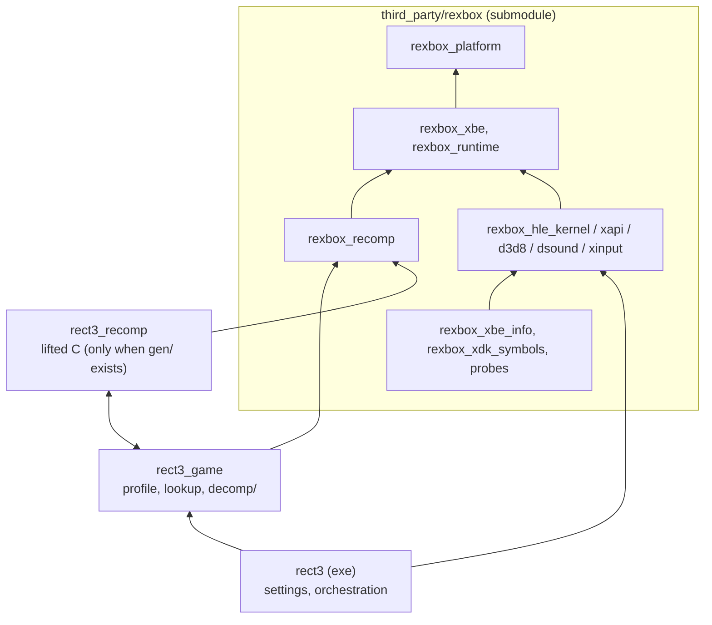
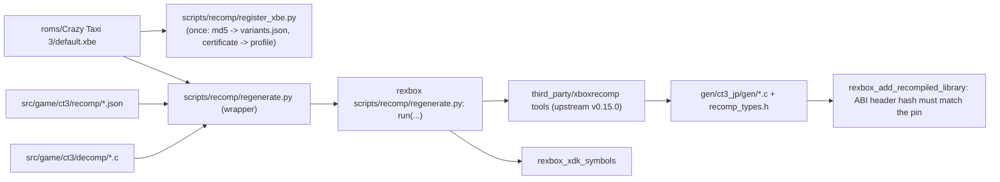

# reCT3 아키텍처

현재 구현된 코드의 구조를 기록한다. 결정의 근거는 [설계 i001](docs/design/20261020-i001-project-bootstrap.md)에 있다. 공유 런타임의 구조는 [rexbox ARCHITECTURE.md](third_party/rexbox/ARCHITECTURE.md)에 있고, 여기에는 이 저장소의 레이어와 rexbox를 쓰는 방식만 적는다.

## 1. 레이어와 CMake 타깃

| 타깃 | 경로 | 책임 | 상태 |
|---|---|---|---|
| `rexbox_*`, `imgui` | `third_party/rexbox/` | 공유 런타임(구조는 rexbox ARCHITECTURE §1). 이 저장소는 `REXBOX_BUILD_TOOLS=ON`으로 도구와 probe도 빌드하고, `REXBOX_XBOXRECOMP_DIR`를 자기 xboxrecomp pin(`third_party/xboxrecomp`, upstream v0.15.0)으로 둔다 | 833e05e (rexbox 브랜치 `i001-project-bootstrap`) |
| `rect3_game` | `src/game/ct3/` | 프로파일(`ct3_profile.cpp`: 인증서로 빌드 식별, `BindTitleHle`로 생성된 XDK 변수 표와 XDK 내부 주소를 `HleRegistry`에 묶음), 생성된 lookup 노출(`ct3_recomp.cpp`), 호스트 훅(`ct3_host.c`, `include/rect3/ct3_host.h`: 와이드스크린 가로 시야 배율), 디컴파일 함수(`decomp/`, 아직 없음), 재컴파일 설정(`recomp/`: `variants.json`, `hle_libraries.json`, `seed_functions.json`, `xdk_symbols_extra.json`) | 일본판 변형은 미등록(값 0) |
| `rect3_recomp` | `gen/ct3_jp/gen/` (gitignore) | lift된 C; rexbox의 `rexbox_add_recompiled_library`가 만든다 | `gen/`이 있을 때만 |
| `rect3` | `src/app/` | 게임 디렉터리의 `default.xbe`(또는 `--xbe <파일>`)를 읽어 내용으로 식별, 설정(`rect3.ini`, Tab 메뉴, 통계 창: reJSRF의 `settings*.cpp`와 같음), 부팅 orchestration과 스레드 보고. `SetDisplayTitle`, `SetApplicationIdentity("reCT3","reCT3")`, `SetDisplayDefaults`, `SetRumbleStrength`로 rexbox에 자기 이름과 기본값을 준다 | 로드 단계까지(게임 없음) |

reJSRF의 `rejsrf_decomp_check`·`rejsrf_d3d8_check`에 해당하는 타이틀 도구는 디컴파일 함수와 lift 원본이 생기면 `tools/`에 만든다(**예정**).

## 2. 재컴파일 코드 생성

* `regenerate.py`는 XBE의 MD5가 `variants.json`의 `ct3_jp`와 같아야 돌고, `md5`가 `null`이면 등록부터 하라고 멈춘다.
* HLE 대상(`hle_libraries.json`): D3D8, D3D8LTCG, DSOUND 전체와 XAPI의 장치·입력 함수 11개. 구현 없는 함수는 실행 중 `stopped at unimplemented XDK function <library> <name>`으로 멈추어 이름을 알려준다(`REXBOX_HLE_FALLBACK=lifted`면 원본 실행). XBE 분석 뒤 조정한다.
* `check_hle_pops.py`, `find_pointer_targets.py`도 rexbox 스크립트의 wrapper다.

## 3. 실행 흐름

rexbox ARCHITECTURE §3과 같다. 앱이 XBE를 식별·배치하고 HLE를 등록한 뒤 `StartInitialThread`로 진입점을 첫 게스트 스레드로 시작한다. 식별되지 않은 빌드는 종료 코드 1, 재컴파일 코드 없는 빌드는 로드 뒤 종료 코드 0.

## 4. 빌드 구성

* 루트 CMake: `rexbox_apply_host_flags()`(MSVC `/utf-8 /permissive- /EHa`, `NOMINMAX` 등), 우리 타깃 `/W4`, `rexbox_check_license`. `rect3`는 `/LARGEADDRESSAWARE`와 `/MAP`.
* `RECT3_RECOMP_GEN_DIR`(기본 `gen/ct3_jp/gen`)이 없으면 `rect3_recomp`를 만들지 않는다(CI).
* 실행 시 환경 변수: `RECT3_HDD_ROOT`(HDD 루트, 기본 `./hdd`)와 rexbox의 `REXBOX_*`(rexbox ARCHITECTURE §5).
* 테스트와 CI: rexbox의 probe 세 개와 앱 smoke 두 개(`src/app/CMakeLists.txt`)가 CTest에 등록되어 `ctest -C <config>`로 돈다. `ci.yml`과 `release.yml`은 rexbox와 같은 규칙이다([설계 i002](docs/design/20261020-i002-github-actions.md)).
* submodule: `third_party/rexbox`(rexbox #1 브랜치 커밋 `833e05e`; 머지되면 태그로 옮김), `third_party/xboxrecomp`(upstream `v0.15.0`, `6376eb8`).

---

# reCT3 Architecture

This records the structure of the code as implemented now; the reasons are in [design i001](docs/design/20261020-i001-project-bootstrap.md). The shared runtime's structure is in [rexbox's ARCHITECTURE.md](third_party/rexbox/ARCHITECTURE.md); only this repository's layers and how it uses rexbox are described here.

## 1. Layers and CMake targets

The diagram and table above apply. `rexbox_*` and `imgui` come from the submodule, built with `REXBOX_BUILD_TOOLS=ON` and `REXBOX_XBOXRECOMP_DIR` at this project's own xboxrecomp pin (upstream v0.15.0). `rect3_game` holds the profile (certificate identification; `BindTitleHle` binds the generated XDK variable table and the XDK internals into the `HleRegistry`), the generated lookup, the host hooks (`include/rect3/ct3_host.h`), the decompiled functions (none yet) and the recompilation configuration; `rect3_recomp` is the lifted C built by rexbox's `rexbox_add_recompiled_library` when `gen/` exists; `rect3` is the app (XBE identification, the settings and overlay as in reJSRF, boot orchestration and thread reports; it hands rexbox its name and defaults through `SetDisplayTitle`, `SetApplicationIdentity`, `SetDisplayDefaults` and `SetRumbleStrength`). Title tools like reJSRF's decomp and d3d8 checks come once decompiled functions and lifted originals exist (**planned**).

## 2. Generating the recompiled code

`scripts/recomp/register_xbe.py` registers the Japan XBE once (MD5 into `variants.json`, certificate values for the profile); `scripts/recomp/regenerate.py` is a wrapper over rexbox's pipeline with this title's paths and this project's xboxrecomp pin, and stops while the variant is unregistered or the XBE's MD5 differs. HLE targets (`hle_libraries.json`): all of D3D8, D3D8LTCG and DSOUND plus XAPI's eleven device and input functions; an unimplemented one stops the run and names itself (`REXBOX_HLE_FALLBACK=lifted` runs the original); to be tuned after the XBE is analyzed. `check_hle_pops.py` and `find_pointer_targets.py` wrap rexbox's scripts too.

## 3. Execution flow

As in rexbox's ARCHITECTURE §3: the app identifies and places the XBE, registers the HLE and starts the entry point as the first guest thread through `StartInitialThread`. An unidentified build exits 1; a build without recompiled code exits 0 after the load stage.

## 4. Build configuration

The root CMake calls `rexbox_apply_host_flags()` (MSVC `/utf-8 /permissive- /EHa`, `NOMINMAX` and friends), builds our targets at `/W4` under `rexbox_check_license`, and links `rect3` with `/LARGEADDRESSAWARE` and `/MAP`. Without `RECT3_RECOMP_GEN_DIR` (default `gen/ct3_jp/gen`) no `rect3_recomp` is created (CI). Run-time variables: `RECT3_HDD_ROOT` (HDD root, default `./hdd`) and rexbox's `REXBOX_*` (rexbox ARCHITECTURE §5). Tests and CI: rexbox's three probes and the two app smoke tests (`src/app/CMakeLists.txt`) are registered with CTest and run with `ctest -C <config>`; `ci.yml` and `release.yml` follow rexbox's rules ([design i002](docs/design/20261020-i002-github-actions.md)). Submodules: `third_party/rexbox` (rexbox #1 branch commit `833e05e`, to move to a tag once merged) and `third_party/xboxrecomp` (upstream `v0.15.0`, `6376eb8`).
