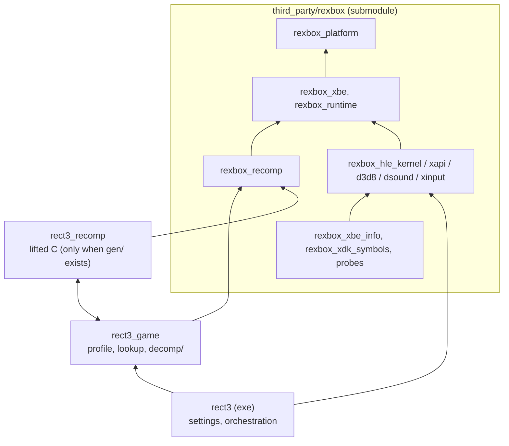
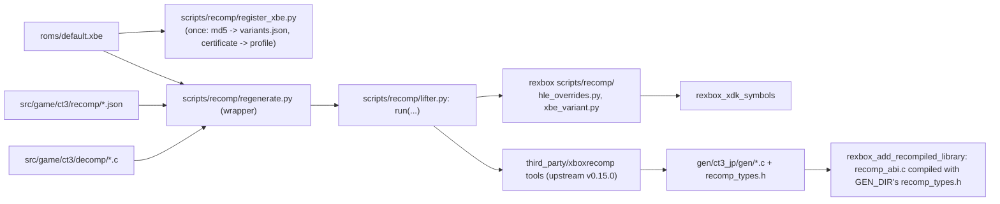

# reCT3 아키텍처

현재 구현된 코드의 구조를 기록한다. 결정의 근거는 [설계 i001](docs/design/20261020-i001-project-bootstrap.md)에 있다. 공유 런타임의 구조는 [rexbox ARCHITECTURE.md](third_party/rexbox/ARCHITECTURE.md)에 있고, 여기에는 이 저장소의 레이어와 rexbox를 쓰는 방식만 적는다.

## 1. 레이어와 CMake 타깃

| 타깃 | 경로 | 책임 | 상태 |
|---|---|---|---|
| `rexbox_*`, `imgui` | `third_party/rexbox/` | 공유 런타임(구조는 rexbox ARCHITECTURE §1). 이 저장소는 `REXBOX_BUILD_TOOLS=ON`으로 도구와 probe도 빌드한다. rexbox는 lifter를 모르며, lifter(`third_party/xboxrecomp`, upstream v0.15.0)는 이 저장소가 고정하고 실행한다 | rexbox `v0.0.14` (`befa752`) |
| `rect3_game` | `src/game/ct3/` | 프로파일(`ct3_profile.cpp`: 인증서로 빌드 식별, `BindTitleHle`로 생성된 XDK 변수 표와 XDK 내부 주소를 `HleRegistry`에 묶음), 생성된 lookup 노출(`ct3_recomp.cpp`), 호스트 훅(`ct3_host.c`, `include/rect3/ct3_host.h`: 와이드스크린 가로 시야 배율), 디컴파일 함수(`decomp/`: `d3dx_matrix.c`, D3DX 행렬 함수 세 개, [분석](docs/analysis/d3dx-matrix.md)), 재컴파일 설정(`recomp/`: `variants.json`, `hle_libraries.json`, `seed_functions.json`, `xdk_symbols_extra.json`) | 일본판 변형은 미등록(값 0) |
| `rect3_recomp` | `gen/ct3_jp/gen/` (gitignore) | lift된 C; rexbox의 `rexbox_add_recompiled_library`가 만든다. rexbox의 `recomp_abi.c`는 OBJECT 타깃 `rect3_recomp_abi`로 같은 디렉터리의 `recomp_types.h`에 맞춰 컴파일되어 여기에 들어간다 | `gen/`이 있을 때만 |
| `rect3` | `src/app/` | 게임 디렉터리의 `default.xbe`(또는 `--xbe <파일>`)를 읽어 내용으로 식별, 설정(`rect3.ini`, Tab 메뉴, 통계 창: reJSRF의 `settings*.cpp`와 같음), 부팅 orchestration과 스레드 보고. `SetDisplayTitle`, `SetApplicationIdentity("reCT3","reCT3")`, `SetDisplayDefaults`, `SetRumbleStrength`로 rexbox에 자기 이름과 기본값을 준다 | 로드 단계까지(게임 없음) |
| `rect3_decomp_check` | `tools/decomp_check/` | 디컴파일 함수마다 같은 게스트 상태에서 lift 원본(`sub_X_gen`)과 함께 돌려 GPR, `g_seh_ebp`, XMM0~7, x87 제어어·top·슬롯, 게스트 메모리 전체를 비교한다. x87·SEH 상태는 생성 코드의 헤더로 읽는 C 보조 파일(`guest_fpu.c`)이 다룬다. CTest에 등록 | `gen/`이 있을 때만([설계 i027](docs/design/20261026-i027-matrix-decomp.md)) |

reJSRF의 `rejsrf_d3d8_check`에 해당하는 도구는 필요해지면 `tools/`에 만든다.

## 2. 재컴파일 코드 생성

* `regenerate.py`는 XBE의 MD5가 `variants.json`의 `ct3_jp`와 같아야 돌고, `md5`가 `null`이면 등록부터 하라고 멈춘다.
* `regenerate.py`는 `rexbox_xdk_symbols`를 Win32 빌드 트리(`build/win32_x86`의 Release, Debug)와 Linux 프리셋 트리(`build/linux-<arch>-<config>`, `RECT3_BUILD_DIR`이 있으면 그 아래도)에서 찾는다. 다른 위치는 `--symbols-tool`로 준다.
* HLE 대상(`hle_libraries.json`): D3D8, D3D8LTCG, DSOUND 전체와 XAPI의 장치·입력 함수 11개. 구현 없는 함수는 실행 중 `stopped at unimplemented XDK function <library> <name>`으로 멈추어 이름을 알려준다(`REXBOX_HLE_FALLBACK=lifted`면 원본 실행). XBE 분석 뒤 조정한다.
* lifter를 실행하고 그 출력 형식(`disasm/functions.json`, `/* ret N */`, `recomp_dispatch.c`, `sub_%08X`·`sub_%08X_gen` 이름)을 읽는 코드는 모두 `scripts/recomp/lifter.py`에 있다. rexbox의 `scripts/recomp/`는 평범한 데이터만 받는 보조 함수(`hle_overrides.py`, `hle_pops.py`, `pointer_targets.py`, `xbe_variant.py`)만 준다([설계 i022](docs/design/20261024-i022-lifter-pipeline.md)).
* `check_hle_pops.py`, `find_pointer_targets.py`는 lift 결과를 `lifter.py`로 읽고, 비교와 XBE 스캔은 rexbox의 `hle_pops.py`, `pointer_targets.py`에 맡긴다.

## 3. 실행 흐름

rexbox ARCHITECTURE §3과 같다. 앱이 XBE를 식별·배치하고 HLE를 등록한 뒤 `StartInitialThread`로 진입점을 첫 게스트 스레드로 시작한다. 식별되지 않은 빌드는 종료 코드 1, 재컴파일 코드 없는 빌드는 로드 뒤 종료 코드 0.

## 4. 빌드 구성

* 루트 CMake: `rexbox_apply_host_flags()`(MSVC `/utf-8 /permissive- /EHa`, `NOMINMAX` 등), 우리 타깃 `/W4`(`rexbox_strict_warnings`). 라이선스 가드 코드는 없다(AGENTS.md 라이선스 규칙). `rect3`는 `/LARGEADDRESSAWARE`와 `/MAP`.
* `RECT3_RECOMP_GEN_DIR`(기본 `gen/ct3_jp/gen`)이 없으면 `rect3_recomp`를 만들지 않는다(CI).
* 실행 시 환경 변수: `RECT3_HDD_ROOT`(HDD 루트, 기본 `./hdd`)와 rexbox의 `REXBOX_*`(rexbox ARCHITECTURE §5).
* 테스트와 CI: rexbox의 probe 세 개, 앱 smoke 두 개(`src/app/CMakeLists.txt`), 생성 코드가 있으면 `rect3_decomp_check`가 CTest에 등록되어 `ctest -C <config>`로 돈다. `ci.yml`과 `release.yml`은 rexbox와 같은 규칙이다([설계 i002](docs/design/20261020-i002-github-actions.md)).
* submodule: `third_party/rexbox`(rexbox `v0.0.14`, `befa752`), `third_party/xboxrecomp`(upstream `v0.15.0`, `6376eb8`).

---

# reCT3 Architecture

This records the structure of the code as implemented now; the reasons are in [design i001](docs/design/20261020-i001-project-bootstrap.md). The shared runtime's structure is in [rexbox's ARCHITECTURE.md](third_party/rexbox/ARCHITECTURE.md); only this repository's layers and how it uses rexbox are described here.

## 1. Layers and CMake targets

The diagram and table above apply. `rexbox_*` and `imgui` come from the submodule, built with `REXBOX_BUILD_TOOLS=ON`; rexbox knows no lifter, and this project pins and runs its own (`third_party/xboxrecomp`, upstream v0.15.0). `rect3_game` holds the profile (certificate identification; `BindTitleHle` binds the generated XDK variable table and the XDK internals into the `HleRegistry`), the generated lookup, the host hooks (`include/rect3/ct3_host.h`), the decompiled functions (`decomp/d3dx_matrix.c`: three D3DX matrix routines, [analysis](docs/analysis/d3dx-matrix.md)) and the recompilation configuration; `rect3_recomp` is the lifted C built by rexbox's `rexbox_add_recompiled_library` when `gen/` exists, together with rexbox's `recomp_abi.c`, compiled as the OBJECT target `rect3_recomp_abi` against the `recomp_types.h` in the same directory; `rect3` is the app (XBE identification, the settings and overlay as in reJSRF, boot orchestration and thread reports; it hands rexbox its name and defaults through `SetDisplayTitle`, `SetApplicationIdentity`, `SetDisplayDefaults` and `SetRumbleStrength`). `rect3_decomp_check` (`tools/decomp_check/`, built with `gen/` only, registered with CTest) runs each decompiled function and its lifted original (`sub_X_gen`) from the same guest state and compares the GPRs, `g_seh_ebp`, XMM0–7, the x87 control word, top and slots, and all of guest memory; a C helper (`guest_fpu.c`) reads the x87 and SEH state through the generated header ([design i027](docs/design/20261026-i027-matrix-decomp.md)). A counterpart of reJSRF's d3d8 check comes when needed.

## 2. Generating the recompiled code

`scripts/recomp/register_xbe.py` registers the Japan XBE once (MD5 into `variants.json`, certificate values for the profile); `scripts/recomp/regenerate.py` runs this project's pipeline (`scripts/recomp/lifter.py`) with this title's paths and the xboxrecomp pin, and stops while the variant is unregistered or the XBE's MD5 differs; it looks for `rexbox_xdk_symbols` in the Win32 tree (`build/win32_x86`, Release then Debug) and in the Linux preset trees (`build/linux-<arch>-<config>`, and under `RECT3_BUILD_DIR` when it is set), and `--symbols-tool` names any other place. HLE targets (`hle_libraries.json`): all of D3D8, D3D8LTCG and DSOUND plus XAPI's eleven device and input functions; an unimplemented one stops the run and names itself (`REXBOX_HLE_FALLBACK=lifted` runs the original); to be tuned after the XBE is analyzed. Everything that runs the lifter or reads its output formats (`disasm/functions.json`, `/* ret N */`, `recomp_dispatch.c`, the `sub_%08X` and `sub_%08X_gen` names) is in `lifter.py`; rexbox's `scripts/recomp/` gives only helpers over plain data (`hle_overrides.py`, `hle_pops.py`, `pointer_targets.py`, `xbe_variant.py`) ([design i022](docs/design/20261024-i022-lifter-pipeline.md)). `check_hle_pops.py` and `find_pointer_targets.py` read the lifted output through `lifter.py` and leave the comparison and the XBE scan to rexbox's `hle_pops.py` and `pointer_targets.py`.

## 3. Execution flow

As in rexbox's ARCHITECTURE §3: the app identifies and places the XBE, registers the HLE and starts the entry point as the first guest thread through `StartInitialThread`. An unidentified build exits 1; a build without recompiled code exits 0 after the load stage.

## 4. Build configuration

The root CMake calls `rexbox_apply_host_flags()` (MSVC `/utf-8 /permissive- /EHa`, `NOMINMAX` and friends), builds our targets at `/W4` (`rexbox_strict_warnings`; there is no license-guard code, see the license rules in AGENTS.md), and links `rect3` with `/LARGEADDRESSAWARE` and `/MAP`. Without `RECT3_RECOMP_GEN_DIR` (default `gen/ct3_jp/gen`) no `rect3_recomp` is created (CI). Run-time variables: `RECT3_HDD_ROOT` (HDD root, default `./hdd`) and rexbox's `REXBOX_*` (rexbox ARCHITECTURE §5). Tests and CI: rexbox's three probes, the two app smoke tests (`src/app/CMakeLists.txt`) and, with generated code, `rect3_decomp_check` are registered with CTest and run with `ctest -C <config>`; `ci.yml` and `release.yml` follow rexbox's rules ([design i002](docs/design/20261020-i002-github-actions.md)). Submodules: `third_party/rexbox` (rexbox `v0.0.14`, `befa752`) and `third_party/xboxrecomp` (upstream `v0.15.0`, `6376eb8`).
