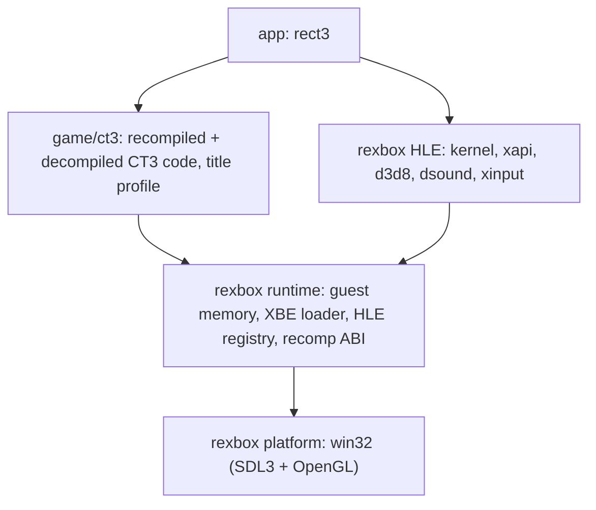

# reCT3

Xbox 게임 **Crazy Taxi 3: High Roller**(일본판)를 정적 재컴파일과 디컴파일로 Win32, Win64, Linux x86, Linux x64, Web, Android에 네이티브 포팅하는 프로젝트입니다. Xbox 커널·XDK·하드웨어를 대신하는 런타임은 [reJSRF](https://github.com/nworkers/reJSRF)와 공유하는 [rexbox](https://github.com/reexec/rexbox)입니다.

> **준비 단계입니다.** 규칙, 레이어, 공유 런타임, 빌드와 CI가 갖춰졌고 게임 XBE는 아직 등록되지 않았습니다. 일본판 `default.xbe`를 `roms/Crazy Taxi 3/`에 두고 `scripts/recomp/register_xbe.py`로 등록하면 분석과 재컴파일이 시작됩니다.

## 게임 데이터는 포함되지 않습니다

이 저장소에는 게임의 실행 파일, 자산, 그리고 실행 파일에서 기계적으로 생성한 코드가 들어 있지 않으며 앞으로도 넣지 않습니다. 직접 소유한 디스크의 덤프를 `roms/`에 두고 사용하세요.

## 구조



* **rexbox**(`third_party/rexbox`, submodule)는 타이틀에 의존하지 않는 재사용 가능한 Xbox 런타임입니다. reJSRF에서 만들어져 분리되었고, 두 프로젝트가 공유합니다.
* **game/ct3**는 원본 x86 코드를 C로 옮긴 재컴파일 코드(로컬 생성)와, 그것을 함수 단위로 대체하는 디컴파일 코드, 타이틀 프로파일을 담습니다.
* **xboxrecomp**(`third_party/xboxrecomp`, submodule)는 upstream v0.15.0입니다. 재컴파일 파이프라인과 lifter ABI 헤더가 여기서 옵니다.
* 자세한 내용: [ARCHITECTURE.md](ARCHITECTURE.md), [설계 i001](docs/design/20261020-i001-project-bootstrap.md), [프로젝트 헌장](docs/PROJECT_CHARTER.md)

## 빌드 (Win32)

```powershell
git clone --recurse-submodules https://github.com/reexec/reCT3.git
cd reCT3
.\scripts\build_win32_x86.ps1          # 실행 정책이 막으면 scripts\build_win32_x86.bat
.\build\win32_x86\src\app\Debug\rect3.exe "roms\Crazy Taxi 3"
```

인자는 디스크에서 추출한 **게임 디렉터리**입니다. 앱은 그 폴더를 게임의 `D:`로 쓰고 `default.xbe`를 읽어 인증서로 식별합니다(`--xbe <파일>`로 다른 XBE). 등록된 일본판이면 실행하고, 아니면 멈춥니다.

자세한 절차: [Win32 개발 환경 준비와 빌드](docs/guides/win32-setup-and-build.md)

## 플랫폼 상태

| 플랫폼 | 상태 |
|---|---|
| Win32 x86 | 빌드됨(게임 없이). rexbox probe 통과 |
| Win64 | 예정 |
| Linux x86 / x64 | 예정 |
| Web (wasm32) | 예정 |
| Android | 예정 |

## 기여와 작업 규칙

[AGENTS.md](AGENTS.md)와 [docs/CODING_STYLE.md](docs/CODING_STYLE.md)를 따릅니다. 규칙은 reJSRF와 같고, 그 바탕은 [reexec/rePIU](https://github.com/reexec/rePIU)입니다.

## 참고 프로젝트

[rexbox](https://github.com/reexec/rexbox), [reJSRF](https://github.com/nworkers/reJSRF), [xboxrecomp](https://github.com/sp00nznet/xboxrecomp) 등. 목록과 라이선스: [rexbox의 docs/kb/external-references.md](third_party/rexbox/docs/kb/external-references.md), [CREDITS.md](CREDITS.md)

## 라이선스

[MIT](LICENSE). 서드파티 코드: [THIRD_PARTY_NOTICES.md](THIRD_PARTY_NOTICES.md). Crazy Taxi는 SEGA의 상표이며, 이 프로젝트는 SEGA 또는 Microsoft와 관련이 없습니다.

---

# reCT3

A native port of the Xbox game **Crazy Taxi 3: High Roller** (the Japan build) to Win32, Win64, Linux x86, Linux x64, the web and Android through static recompilation and decompilation. The runtime that stands in for the Xbox kernel, the XDK and the hardware is [rexbox](https://github.com/reexec/rexbox), shared with [reJSRF](https://github.com/nworkers/reJSRF).

> **Preparation stage.** The rules, layers, shared runtime, build and CI are in place; the game XBE is not registered yet. Put the Japan `default.xbe` under `roms/Crazy Taxi 3/` and register it with `scripts/recomp/register_xbe.py` to start analysis and recompilation.

## No game data included

This repository does not and will not contain the game's executable, its assets, or code mechanically generated from the executable. Put a dump of a disc you own under `roms/`.

## Structure

See the diagram above. **rexbox** (`third_party/rexbox`, a submodule) is the reusable, title-agnostic Xbox runtime, built in reJSRF and split out for both projects; **game/ct3** holds the recompiled code (the original x86 lifted to C, generated locally), the decompiled code that replaces it function by function, and the title profile; **xboxrecomp** (`third_party/xboxrecomp`, a submodule) is upstream v0.15.0, the source of the recompilation pipeline and the lifter ABI header. More: [ARCHITECTURE.md](ARCHITECTURE.md), [design i001](docs/design/20261020-i001-project-bootstrap.md), [project charter](docs/PROJECT_CHARTER.md).

## Build (Win32)

See the commands above, and [Win32 development setup and build](docs/guides/win32-setup-and-build.md) for the full procedure. The argument is the **game directory** extracted from the disc; the app serves it as the game's `D:`, loads `default.xbe` (or the file `--xbe` names) and identifies it by its certificate: the registered Japan build runs, anything else stops.

## Platform status

Win32 x86 builds (without a game) and the rexbox probes pass; Win64, Linux x86/x64, the web (wasm32) and Android are planned.

## Contributing and working rules

Follow [AGENTS.md](AGENTS.md) and [docs/CODING_STYLE.md](docs/CODING_STYLE.md). The rules are those of reJSRF, based on [reexec/rePIU](https://github.com/reexec/rePIU).

## License

[MIT](LICENSE). Third-party code: [THIRD_PARTY_NOTICES.md](THIRD_PARTY_NOTICES.md). Crazy Taxi is a trademark of SEGA; this project is not affiliated with SEGA or Microsoft.
