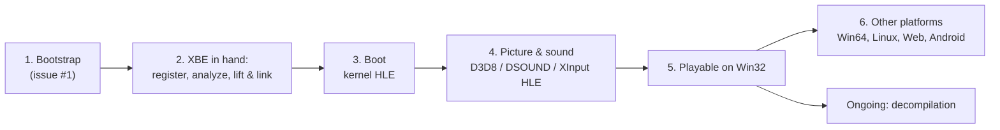

# 프로젝트 헌장

## 목적

reCT3는 Xbox 게임 Crazy Taxi 3: High Roller를 정적 재컴파일과 디컴파일로 Win32, Win64, Linux x86, Linux x64, Web, Android에서 네이티브로 실행되게 만든다.

게임 로직은 원본 x86 코드에서 기계적으로 옮긴 코드가 담당하고, 디컴파일은 그 코드를 같은 동작의 읽을 수 있는 코드로 바꿔 간다. Xbox 커널, XDK 라이브러리, 하드웨어를 대신하는 HLE와 호스트 플랫폼 서비스는 reJSRF와 공유하는 런타임 [rexbox](https://github.com/reexec/rexbox)가 맡고, 이 저장소는 타이틀 계층과 앱에 집중한다.

## Purpose

reCT3 makes the Xbox game Crazy Taxi 3: High Roller run natively on Win32, Win64, Linux x86, Linux x64, the web and Android through static recompilation and decompilation.

Game logic is carried by code mechanically lifted from the original x86, and decompilation gradually turns that code into readable code of the same behavior. The HLE that stands in for the Xbox kernel, the XDK libraries and the hardware, and the host platform services, are the shared runtime [rexbox](https://github.com/reexec/rexbox), which reJSRF uses too; this repository focuses on the title layer and the app.

## 현재 1차 목표

* 1차 타깃 실행 파일은 일본판 `default.xbe`다. 아직 손에 없으며, 준비되면 `scripts/recomp/register_xbe.py`로 신원(MD5, 인증서)을 등록하고 분석을 시작한다. 다른 지역판은 식별만 한다(발견되면).
* 1차 호스트는 Win32 x86이다. 어느 정도 진행된 뒤 Win64, Linux x86/x64, Web, Android로 넓힌다.
* lifter는 upstream xboxrecomp v0.15.0이며, 이 저장소가 고정하고 실행한다(rexbox는 lifter를 모른다, rexbox issue #26). reJSRF의 fork에만 있는 lifter 수정이 필요해지면 upstream PR로 해결한다.

## Current First Target

* The first target executable is the Japan build `default.xbe`. It is not in hand yet; once it is, `scripts/recomp/register_xbe.py` registers its identity (MD5, certificate) and analysis starts. Other regional builds are recognized only (when found).
* The first host is Win32 x86. Once the project is well along, it widens to Win64, Linux x86/x64, the web and Android.
* The lifter is upstream xboxrecomp v0.15.0, pinned and run by this repository (rexbox knows no lifter, rexbox issue #26). Lifter fixes that exist only in reJSRF's fork are taken through upstream pull requests when needed.

## 방향성

* 재컴파일된 원본 코드를 기준 구현으로 취급한다.
* 에뮬레이터(xemu, Cxbx-Reloaded)를 통합하지 않는다. 동작 비교의 기준으로만 쓴다.
* 재사용 가능한 Xbox 런타임 `rexbox`와 타이틀 코드 `rect3`를 분리한다. rexbox에 필요한 변경은 rexbox 저장소에서 한다.
* HLE는 API 경계(커널 ordinal, XDK 라이브러리 함수)에서 하고, 하드웨어 LLE는 필요한 지점에만 둔다.
* 게임 데이터와 그것에서 생성한 코드는 저장소에 넣지 않는다. 사용자가 자기 덤프로 만든다.
* 라이선스는 MIT이며, 전염성 라이선스 코드는 빌드에 넣지 않는다.
* 코드 변경 전에는 설계와 작업 계획을 문서화한다.
* 프로젝트 버전은 `VERSION` 파일의 `major.minor.patch` 형식으로 관리한다.

## Direction

* Treat the recompiled original code as the reference implementation.
* Do not integrate an emulator (xemu, Cxbx-Reloaded); use one only as a reference for comparing behavior.
* Keep the reusable Xbox runtime `rexbox` separate from the title code `rect3`; changes rexbox needs are made in its repository.
* Do HLE at API boundaries (kernel ordinals, XDK library functions), with hardware LLE only where needed.
* Keep game data and code generated from it out of the repository; users build it from their own dump.
* The license is MIT, and copyleft code is not built in.
* Document design and work plans before changing code.
* Manage the project version in the `VERSION` file using `major.minor.patch`.

## 단계

1. 부트스트랩: 규칙, 레이어, 공유 rexbox submodule, Win32 빌드 골격(게임 없이).
2. 일본판 XBE 등록과 분석, 재컴파일 파이프라인 연결: XBE를 lift해 Win32에서 링크한다.
3. 커널 HLE로 진입점부터 부팅한다.
4. D3D8, DSOUND, XInput HLE로 화면과 소리를 낸다. CT3의 XDK 버전에 따라 rexbox의 HLE를 넓힌다.
5. Win32에서 플레이 가능.
6. Win64, Linux, Web, Android로 확장한다. 디컴파일은 2단계 이후 계속 진행한다.

## Stages

1. Bootstrap: rules, layers, the shared rexbox submodule, a Win32 build skeleton (without a game).
2. Register and analyze the Japan XBE and connect the recompilation pipeline: lift the XBE and link it on Win32.
3. Boot from the entry point on kernel HLE.
4. Picture and sound through D3D8, DSOUND and XInput HLE, widening rexbox's HLE as CT3's XDK version requires.
5. Playable on Win32.
6. Widen to Win64, Linux, the web and Android. Decompilation proceeds continuously from stage 2 on.
