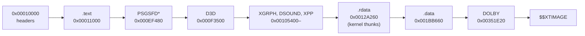

# CT3 XBE 구조와 설계 (한국어)

원본 XBE 분석으로 확인한 구조를 누적한다. 상세 근거와 확인 상태는 [`docs/analysis/`](analysis/README.md)에 있고, 여기에는 설계에 영향을 주는 결론만 모은다. 영어판: [XBE_DESIGN.en.md](XBE_DESIGN.en.md).

## 1. 대상 빌드

* 1차 타깃은 일본판 `default.xbe`(지역 2, title id `53450004`, MD5 `18a88739…`, XDK 4531)다. → [ct3-xbe-overview §1](analysis/ct3-xbe-overview.md)
* 다른 지역판이 발견되면 식별만 하고, 주소는 공유하지 않는 것으로 본다(**추정**).

## 2. 메모리 배치

* 이미지 끝은 `0x0035B7A0`(base + `0x34B7A0`)이다. 64 MiB 게스트 RAM 안에 들어간다.
* kernel thunk 표는 `.rdata`의 첫 주소 `0x0012A260`에 있다. 121개 슬롯.
* 타이틀은 D3D 리소스의 물리 주소에 `0x80000000`/`0xF0000000`을 OR해 CPU 포인터로 쓴다. 그래서 reCT3는 rexbox의 물리 메모리 창을 켠다(`GuestMemory::Options::physical_window`, rexbox 설계 i008).

## 3. HLE 설계에 주는 결론

* XDK 4531이다. rexbox의 D3D8 HLE(렌더 상태 번호, Caps, 기본 상태 루틴)는 4134 기준이라 4531 배치를 받아야 한다(rexbox #7). 식별된 `D3DRS_*` 변수로 deferred·complex 블록이 4134보다 한 slot 위임을 확인했다.
* 부팅은 DVD 드라이브의 SCSI pass-through(MODE SENSE 페이지 0x3E)로 디스크 인증을 확인하고, 아니면 대시보드로 돌아간다(rexbox #6에서 답).
* DSOUND는 4531의 공개 함수(`XAudioDownloadEffectsImage`, `IDirectSound_SetMixBinHeadroom`, `IDirectSoundBuffer_SetPitch` 등)가 더 필요하다(rexbox #9).
* 커널 import 121개 중 17개가 HLE에 없다(목록은 analysis §5). 부팅이 닿으면 그때 구현한다.

## 4. 시작 순서와 커널 구조

* 진입점 `0xE0934`는 XAPI 시작 코드다(JSRF와 같은 모양). 메인 스레드 `0xDDF9D`가 디스크 검사 → 드라이브 연결(D:, T:, U:, Z: 포맷) → 캐시 파일 조회 → D3D 디바이스 → 셰이더·텍스처 → DirectSound 순서로 진행한다. → [ct3-xbe-overview §7](analysis/ct3-xbe-overview.md)

---

(영어 번역은 [XBE_DESIGN.en.md](XBE_DESIGN.en.md)에 있다.)
