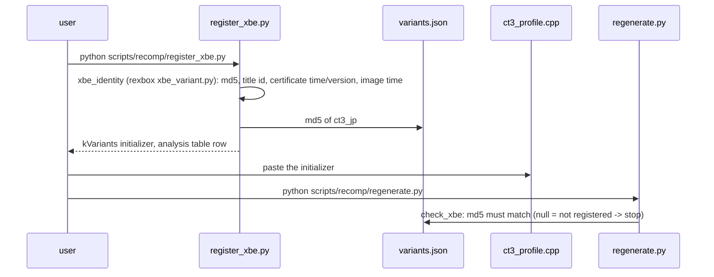

# 설계: 프로젝트 부트스트랩과 공유 rexbox 위의 레이어 구조 (issue #1)

## 1. 요구사항

* Xbox 게임 Crazy Taxi 3: High Roller(일본판)를 reJSRF와 같은 방법(정적 재컴파일 + 디컴파일 + HLE)으로 포팅하는 프로젝트를 만든다. 원격 저장소는 `reexec/reCT3`.
* reJSRF에서 현재 구현된 것 중 JSRF 전용이 아닌 것은 모두 동일하게 가져온다. 런타임(rexbox)은 별도 저장소 `reexec/rexbox`로 분리해 reJSRF와 공유한다([rexbox 설계 i001](https://github.com/reexec/rexbox/blob/i001-project-bootstrap/docs/design/20261020-i001-project-bootstrap.md)).
* xboxrecomp는 upstream 최신 버전(v0.15.0)을 쓴다.
* 작업 규칙은 reJSRF와 동일하게 따른다.
* 게임 XBE는 아직 없다. 이번 범위는 준비(규칙, 레이어, 빌드, 등록 절차)까지다. reJSRF 저장소는 건드리지 않는다(사용자 지시).

## 2. reJSRF에서 가져오는 것과 남기는 것

| reJSRF | reCT3 | 판단 |
|---|---|---|
| `src/rexbox`, `src/platform`, `include/rexbox`, `cmake`, 도구 5개 | `third_party/rexbox` (submodule) | 공유 런타임 |
| `src/app/{main,settings,settings_ui}.*`, `build_stamp.cmake` | `src/app/` (이름만 `rect3`) | 타이틀 독립적인 앱. 설정 메뉴·통계 창·`rect3.ini` 그대로 |
| `src/game/jsrf/{jsrf_profile,jsrf_recomp}.cpp`, `jsrf_host.c`, `include/rejsrf/*` | `src/game/ct3/`, `include/rect3/` | 구조 동일, 변형 표는 일본판 자리(미등록) |
| `src/game/jsrf/decomp/*.c`, `recomp/seed_*.json`, `xdk_symbols_extra.json`의 내용 | (가져오지 않음) | JSRF 주소 |
| `src/game/jsrf/recomp/hle_libraries.json` | `recomp/hle_libraries.json` | DSOUND는 함수 목록 대신 라이브러리 전체(§5) |
| `scripts/recomp/*.py` | rexbox 스크립트의 wrapper + `register_xbe.py` | |
| `tools/{decomp_check,d3d8_check}` | (예정) | lift 원본이 생기면 |
| `docs/analysis`, `docs/XBE_DESIGN.*`, `docs/design`·`work-*`, 릴리스 노트 | 새로 시작 | 타이틀 이력 |
| `docs/kb` | rexbox의 것을 참조 | 일반 Xbox 지식 |
| `AGENTS.md`, `CLAUDE.md`, `docs/CODING_STYLE.md`, `docs/PROJECT_CHARTER.md`, CI | 같은 규칙으로 작성 | |
| `scripts/fetch_references.ps1` | (없음) | JSRF 참고 저장소 목록 |

앱 코드의 공유: `settings*.cpp`는 두 타이틀에 거의 같은 사본으로 남는다. rexbox로 올리는 것은 이름(ini 파일, 창 제목)과 기본 해상도를 매개변수로 만들어야 하는 별도 작업이다(**미확정**, rexbox의 후속 issue 후보).

## 3. 레이어 구조

```mermaid
flowchart TD
    APP["app (rect3.exe)<br/>orchestration, settings"]
    subgraph TITLE["game/ct3 (title-specific)"]
        PROFILE["ct3_profile<br/>XBE identity, HLE bindings"]
        DECOMP["decomp/<br/>hand-written functions (none yet)"]
        RECOMP["gen/ct3_jp/<br/>lifted C (gitignored)"]
        CFG["recomp/<br/>variants, seeds, hle_libraries"]
    end
    subgraph REXBOX["third_party/rexbox (shared, title-agnostic)"]
        RUNTIME["runtime, recomp ABI adapter"]
        XBE["xbe"]
        HLE["hle: kernel, xapi, d3d8, dsound, xinput"]
        PLATFORM["platform: win32 (SDL3)"]
    end
    XR["third_party/xboxrecomp (upstream v0.15.0)<br/>pipeline tools, lifter ABI header"]

    APP --> TITLE
    APP --> HLE
    TITLE --> RUNTIME
    HLE --> RUNTIME
    RUNTIME --> XBE
    RUNTIME --> PLATFORM
    CFG -. regenerate.py .-> RECOMP
    XR -. tools, recomp_types.h .-> RECOMP
    XR -. REXBOX_XBOXRECOMP_DIR .-> RUNTIME
```

* 루트 CMake는 `REXBOX_BUILD_TOOLS=ON`, `REXBOX_XBOXRECOMP_DIR=third_party/xboxrecomp`로 rexbox를 `add_subdirectory`하고 `rexbox_apply_host_flags()`를 부른다. 생성 코드 타깃은 `rexbox_add_recompiled_library(rect3_recomp GEN_DIR gen/ct3_jp/gen TITLE rect3_game)`.
* 앱이 rexbox에 주는 것: `SetDisplayTitle("reCT3 v... - Build ...")`, `SetApplicationIdentity("reCT3", "reCT3")`(사용자 설정 폴더), `SetDisplayDefaults`(ini의 표시 기본값), `SetRumbleStrength`, 와이드스크린 가로 시야 훅.

## 4. 일본판 XBE의 등록

XBE가 없으므로 프로파일의 변형 표는 값 0인 "Japan" 한 항목이고 `variants.json`의 `md5`는 `null`이다.



* `IdentifyXbe`는 title id가 0인 항목을 건너뛰므로 등록 전에는 어떤 XBE도 식별되지 않고 앱은 종료 코드 1로 멈춘다.
* 인증서 값을 코드에 두는 것은 reJSRF와 같다(빌드 식별에 필요한 신원이며 게임 코드가 아니다).
* title id 등 공개 정보를 미리 적지 않는 이유: 확인되지 않은 값을 "확인됨"처럼 두지 않기 위해서다(AGENTS 분석 규칙).

## 5. HLE 대상과 알려진 위험

* `hle_libraries.json`: D3D8·D3D8LTCG·DSOUND 라이브러리 전체와 XAPI 장치·입력 함수 11개. reJSRF는 DSOUND를 "게임이 부르는 함수" 목록으로 골랐지만, CT3가 무엇을 부르는지 모르므로 라이브러리 전체를 HLE로 보내 구현 없는 함수가 이름을 대고 멈추게 한다. 분석 뒤 조정한다.
* **XDK 버전**: CT3가 JSRF(XDK 4134)와 다른 XDK면 D3D8 렌더 상태 번호·Caps·기본 상태 루틴이 달라 rexbox의 D3D8 HLE를 손봐야 할 수 있다(**미확정**, [ct3-xbe-overview §1](../analysis/ct3-xbe-overview.md)).
* **lifter**: upstream v0.15.0에는 reJSRF fork의 수정 일부(PR #200 계열)가 아직 없다. CT3가 같은 문제(다른 함수 본문 중간으로 가는 분기)를 만나면 upstream PR 또는 fork로 대응한다(**미확정**).
* **XbSymbolDatabase**: CT3의 XDK 빌드에 대한 시그니처가 있어야 D3D8 함수가 식별된다. 없으면 `xdk_symbols_extra.json`으로 보충한다(**미확정**).

## 6. 저장소 구성

| 경로 | 내용 |
|---|---|
| `include/rect3/`, `src/game/ct3/` | 타이틀 프로파일, 호스트 훅, `decomp/`, `recomp/` 설정 |
| `src/app/` | 실행 파일 진입점과 설정 |
| `scripts/` | 빌드 스크립트, 재컴파일 wrapper, `register_xbe.py` |
| `third_party/rexbox/`, `third_party/xboxrecomp/` | submodule |
| `docs/` | 헌장, 코딩 스타일, XBE 설계, analysis, kb(색인만), guides, design, work-orders, work-logs |
| `roms/`, `gen/`, `build/` | 로컬 전용(gitignore) |

## 7. 이번 task의 검증

* Win32 x86 Debug/Release 빌드(우리 타깃 /W4 경고 없음).
* rexbox probe 세 개 0 failure.
* `rect3.exe`가 파일과 XBE 없는 디렉터리를 종료 코드 1로 거부하고, 등록되지 않은 XBE를 "not a supported ... build"로 거부한다.
* `register_xbe.py --dry-run`이 XBE의 신원을 출력하고, `regenerate.py`가 미등록 변형에서 멈춘다.
* CI 워크플로가 같은 검사를 한다.

---

# Design: project bootstrap and the layer structure on the shared rexbox (issue #1)

## 1. Requirements

* Create a project that ports the Xbox game Crazy Taxi 3: High Roller (Japan build) the way reJSRF does (static recompilation, decompilation, HLE); remote `reexec/reCT3`.
* Bring everything reJSRF implements that is not JSRF-specific, identically. The runtime (rexbox) is split into its own repository `reexec/rexbox` and shared with reJSRF ([rexbox design i001](https://github.com/reexec/rexbox/blob/i001-project-bootstrap/docs/design/20261020-i001-project-bootstrap.md)).
* xboxrecomp is upstream's latest, v0.15.0.
* The working rules are reJSRF's.
* The game XBE is not in hand; this task prepares (rules, layers, build, registration procedure). The reJSRF repository is not touched (user instruction).

## 2. What comes from reJSRF and what stays

The table above: the runtime becomes the `third_party/rexbox` submodule; the app (`main`, `settings`, `settings_ui`, build stamp) and the title-layer skeleton (profile, lookup, host hooks) come over under the `rect3` names; JSRF's decompiled functions, seeds and extra symbols do not (they are JSRF addresses); `hle_libraries.json` sends the whole DSOUND library to the HLE (§5); the scripts become wrappers over rexbox's plus `register_xbe.py`; the two title check tools come later; analysis, design history and release notes start fresh; general knowledge is rexbox's `docs/kb/`. Sharing the settings code itself through rexbox would need its names and default resolution made parameters, a separate task (**unresolved**, a rexbox issue candidate).

## 3. Layer structure

As in the diagram: the root CMake adds rexbox with `REXBOX_BUILD_TOOLS=ON` and `REXBOX_XBOXRECOMP_DIR=third_party/xboxrecomp`, calls `rexbox_apply_host_flags()`, and builds the generated code with `rexbox_add_recompiled_library(rect3_recomp GEN_DIR gen/ct3_jp/gen TITLE rect3_game)`. The app hands rexbox its window title, `SetApplicationIdentity("reCT3", "reCT3")` for the settings folder, the display defaults from the ini, the rumble strength and the widescreen view hook.

## 4. Registering the Japan XBE

Without the XBE the profile's variant table has one "Japan" entry with zero values and `variants.json` has `md5: null`. `register_xbe.py` reads the identity (MD5, title id, certificate time and version, image time) with rexbox's `xbe_variant.py`, writes the MD5 into `variants.json`, and prints the `kVariants` initializer and the analysis table row for the user to paste; `regenerate.py` then checks the MD5 and stops while it is null. `IdentifyXbe` skips entries with title id 0, so before registration no XBE is identified and the app exits 1. Keeping certificate values in code is as in reJSRF (identity, not game code); public values are not pre-filled, so nothing unconfirmed is presented as confirmed.

## 5. HLE targets and known risks

`hle_libraries.json` sends all of D3D8, D3D8LTCG and DSOUND plus XAPI's eleven device and input functions to the HLE, so an unimplemented function stops and names itself; to be tuned after analysis. Risks (**unresolved**): a different XDK version than JSRF's 4134 may change D3D8 render-state numbers, caps and the default-state routine, needing changes in rexbox's D3D8 HLE; upstream v0.15.0 lacks some of reJSRF's fork fixes (the PR #200 family), to be taken upstream if CT3 hits them; XbSymbolDatabase must carry signatures for CT3's XDK build, else `xdk_symbols_extra.json` supplements them.

## 6. Repository layout

As in the table above.

## 7. Verification for this task

Win32 x86 Debug and Release builds without warnings on our targets; the three rexbox probes at 0 failures; `rect3.exe` rejecting a file and a directory without an XBE with exit code 1 and an unregistered XBE as "not a supported ... build"; `register_xbe.py --dry-run` printing an XBE's identity and `regenerate.py` stopping on the unregistered variant; CI running the same checks.
