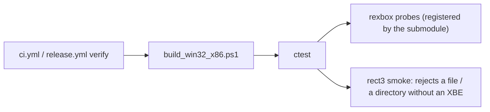

# 설계: GitHub Actions — main 검증, 태그 검증, 릴리스 (issue #2)

규칙은 [rexbox 설계 i002](https://github.com/reexec/rexbox/blob/i001-project-bootstrap/docs/design/20261020-i002-github-actions.md)와 같다. 여기에는 reCT3에서 다른 점만 적는다.

## 1. 요구사항

* `main` 반영 시 빌드와 테스트를 검증한다. 태그를 검증하고, 릴리스 노트가 있는 태그는 GitHub Release를 만든다. 산출물은 소스만이다. 사용자 지시: "github actions 규칙은 reCT3도 동일".

## 2. reCT3에서 다른 점

| 항목 | 결정 |
|---|---|
| 테스트 | 루트 `enable_testing()`. rexbox submodule이 등록하는 probe 세 개에 더해 `src/app/CMakeLists.txt`가 앱 smoke 두 개를 `add_test`한다(`rect3 LICENSE` → `is not a directory`, `rect3 docs` → `has no default.xbe`; `PASS_REGULAR_EXPRESSION`으로 메시지를 확인). 이전 CI의 PowerShell smoke 단계를 대체한다 |
| 체크아웃 | `submodules: recursive`(rexbox 안의 submodule까지) |
| 게임 데이터 | CI에는 없으므로 재컴파일 코드 없는 구성만 검증한다. XBE가 필요한 검증은 로컬 가이드 |
| 릴리스 | 제목 `reCT3 <tag>`. 소스 아카이브에는 submodule이 없으므로 릴리스 노트와 README가 `--recurse-submodules` clone을 안내한다 |

## 3. 검증

* 로컬 `ctest -C Debug` / `-C Release`: 5개 테스트 통과.
* Actions는 push 뒤 PR과 첫 태그에서 돈다.

---

# Design: GitHub Actions — main verification, tag verification, releases (issue #2)

The rules are those of [rexbox design i002](https://github.com/reexec/rexbox/blob/i001-project-bootstrap/docs/design/20261020-i002-github-actions.md); only reCT3's differences are recorded here. Tests: `enable_testing()` at the root; besides the three probes the rexbox submodule registers, `src/app/CMakeLists.txt` adds two app smoke tests (`rect3 LICENSE` must say `is not a directory`, `rect3 docs` must say `has no default.xbe`, checked with `PASS_REGULAR_EXPRESSION`), replacing the former PowerShell smoke step. Checkout uses `submodules: recursive`. CI holds no game data, so only the no-recompiled-code configuration is verified; XBE-dependent checks stay in the local guide. The release title is `reCT3 <tag>`; since source archives hold no submodules, the release note and README point at a `--recurse-submodules` clone. Verification: local `ctest -C Debug` and `-C Release` pass the five tests; Actions run after the push on the pull request and the first tag.
