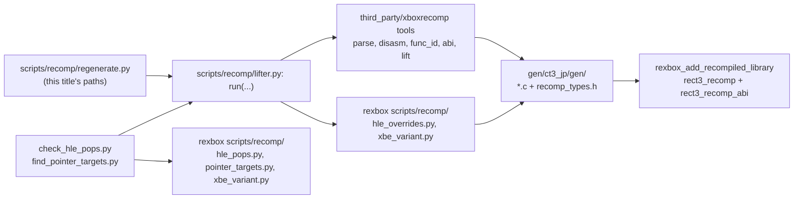

# 설계: lifter 파이프라인을 이 저장소로 옮김 (issue #22)

rexbox 설계: [20261024-i026-drop-xboxrecomp](../../third_party/rexbox/docs/design/20261024-i026-drop-xboxrecomp.md)(rexbox issue #26). 여기에는 reCT3 쪽 결정만 적는다.

## 1. 요구사항

* rexbox #26을 따른다. rexbox는 xboxrecomp 체크아웃, 도구, 출력 형식을 모르게 되었다. 지워진 것은 CMake 변수 `REXBOX_XBOXRECOMP_DIR`, ABI 헤더 해시 검사, 라이선스 가드(`rexbox_check_license`, `REXBOX_COPYLEFT_PATHS`), rexbox의 xboxrecomp submodule, `scripts/recomp/regenerate.py`·`check_hle_pops.py`·`find_pointer_targets.py`다.
* lifter를 고정하는 쪽은 이 저장소(`third_party/xboxrecomp`, upstream v0.15.0)이므로 파이프라인과 lifter 출력 읽기를 여기로 옮긴다. 생성 결과는 이전과 같아야 한다.

## 2. 설계

| 위치 | 가진 것 |
|---|---|
| `scripts/recomp/lifter.py`(이 저장소) | xboxrecomp 다섯 단계(parse, disasm, func_id, abi, lift) 실행, seed와 덮어쓰기(`--exclude-manual`) 수집, 출력 읽기(`disasm/functions.json`, `/* ret N */`, `recomp_dispatch.c`), lifter의 이름 규칙(`sub_%08X`, `sub_%08X_gen`) |
| rexbox `scripts/recomp/` | 평범한 데이터를 받는 함수: `hle_overrides.py`(`rexbox_xdk_symbols` 실행, HLE 덮어쓰기 생성), `hle_pops.py`, `pointer_targets.py`, `xbe_variant.py` |
| `regenerate.py`, `check_hle_pops.py`, `find_pointer_targets.py` | 이 타이틀의 경로를 채우는 CLI. lift 결과는 `lifter.py`로 읽고 비교·스캔은 rexbox 함수에 맡긴다 |
| `register_xbe.py` | 바뀌지 않는다(rexbox의 `xbe_variant`가 남는다) |

* CMake: `REXBOX_XBOXRECOMP_DIR`를 지운다. `third_party/xboxrecomp`의 존재 검사는 경로로 남긴다. `rexbox_check_license` 호출을 지운다. rexbox의 `recomp_abi.c`는 `rexbox_add_recompiled_library`가 OBJECT 타깃 `rect3_recomp_abi`로, lifter가 `gen/ct3_jp/gen/`에 쓴 `recomp_types.h`에 맞춰 컴파일한다.
* 라이선스: 타이틀 쪽 가드 코드를 두지 않는다. 우리 타깃은 생성 코드와 그 옆의 MIT 헤더만 컴파일한다. xboxrecomp의 LGPL 파일(`src/apu/*`, `src/nv2a/nv2a_core.c`, `src/nv2a/nv2a_regs.h`, `src/nv2a/nv2a_state.h`)과 `include/xbox/xboxrecomp.h`는 어느 소스 목록에도 넣지 않는다는 규칙을 `AGENTS.md`에 둔다. 가드는 체크아웃 경로를 하드코딩해야 하고, 지금 그 파일을 소스 목록에 넣을 경로가 없어서 규칙으로 충분하다고 보았다.
* 재컴파일 코드 재생성은 필요 없다. ABI와 생성 내용이 바뀌지 않는다.

## 3. 검증

* 옮긴 파이프라인으로 `ct3_jp`를 재생성해 이전 출력(같은 xboxrecomp, 같은 XBE)과 비교한다. lift된 C는 바이트 단위로 같아야 한다.
* `check_hle_pops --all`, `find_pointer_targets`의 출력이 이전과 같아야 한다.
* Win32 x86 Release 빌드와 운전 구간 실행([작업 로그](../work-logs/20261024-i022-lifter-pipeline.md)).

---

# Design: moving the lifter pipeline into this repository (issue #22)

rexbox design: [20261024-i026-drop-xboxrecomp](../../third_party/rexbox/docs/design/20261024-i026-drop-xboxrecomp.md) (rexbox issue #26). Only reCT3's decisions are recorded here.

Requirement: follow rexbox #26, after which rexbox knows no xboxrecomp checkout, tools or output formats; gone are the CMake variable `REXBOX_XBOXRECOMP_DIR`, the ABI header hash check, the license guard (`rexbox_check_license`, `REXBOX_COPYLEFT_PATHS`), rexbox's xboxrecomp submodule and its `scripts/recomp/regenerate.py`, `check_hle_pops.py` and `find_pointer_targets.py`. This repository pins the lifter (`third_party/xboxrecomp`, upstream v0.15.0), so the pipeline and the readers of the lifter's output move here, with unchanged output.

Design (diagram above): `scripts/recomp/lifter.py` runs the five xboxrecomp stages (parse, disasm, func_id, abi, lift), gathers the seeds and the overrides (`--exclude-manual`), reads the lifter's output (`disasm/functions.json`, `/* ret N */`, `recomp_dispatch.c`) and holds its naming (`sub_%08X`, `sub_%08X_gen`). rexbox's `scripts/recomp/` keeps functions over plain data: `hle_overrides.py` (runs `rexbox_xdk_symbols`, writes the HLE overrides), `hle_pops.py`, `pointer_targets.py`, `xbe_variant.py`. `regenerate.py`, `check_hle_pops.py` and `find_pointer_targets.py` are CLIs with this title's paths that read the lifted output through `lifter.py` and leave comparison and scanning to rexbox's functions; `register_xbe.py` is unchanged (rexbox's `xbe_variant` stays). CMake: `REXBOX_XBOXRECOMP_DIR` is removed, the existence check of `third_party/xboxrecomp` stays by path, and the `rexbox_check_license` call is removed; `rexbox_add_recompiled_library` compiles rexbox's `recomp_abi.c` as the OBJECT target `rect3_recomp_abi` against the `recomp_types.h` the lifter wrote into `gen/ct3_jp/gen/`. License: no title-side guard code. Our targets compile only the generated code and the MIT header next to it, and `AGENTS.md` holds the rule that xboxrecomp's LGPL files (`src/apu/*`, `src/nv2a/nv2a_core.c`, `src/nv2a/nv2a_regs.h`, `src/nv2a/nv2a_state.h`) and `include/xbox/xboxrecomp.h` are never added to a source list; a guard would hard-code checkout paths, and no path puts those files into a source list now, so the rule was judged enough. No regeneration is needed: the ABI and the generated content do not change.

Verification: regenerate `ct3_jp` with the moved pipeline and compare with the earlier output (same xboxrecomp, same XBE), the lifted C byte for byte; `check_hle_pops --all` and `find_pointer_targets` print the same as before; a Win32 x86 Release build and a driving run ([work log](../work-logs/20261024-i022-lifter-pipeline.md)).
