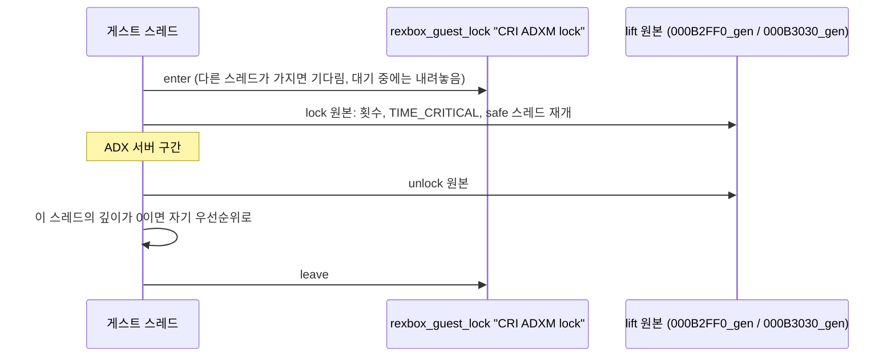

# 설계: CRI ADXM 잠금의 호스트 상호 배제 (issue #29)

## 1. 문제

* Linux x64 실기에서 직접 플레이하는 중에 음악이 한 구간을 계속 반복한다. 화면과 게임은 정상으로 진행한다. Windows에서는 이 증상이 없었다(사용자 보고).
* 음악은 CRI ADX 스트림(`D:\Media\ADX\ADX0.AFS`)이다. ADX 서버가 스트림을 계속 채우지 못하면 DirectSound 버퍼가 같은 내용을 반복해서 재생한다(**추정**).
* CT3의 ADXM 잠금은 reJSRF와 같은 구조다([분석](../analysis/cri-middleware.md) §3). 전역 횟수 하나와 저장 우선순위 하나로 이루어져 있고, 상호 배제는 단일 코어의 TIME_CRITICAL 스케줄링에만 기댄다. 호스트에서는 게스트 스레드가 동시에 돌기 때문에 두 스레드가 ADX 서버를 함께 돌릴 수 있다. reJSRF에서는 같은 원인이 멈춤으로 나타났다(reJSRF #68, #91, #100).
* 데모 숨김 실행에서 경합이 실제로 일어남을 확인했다(분석 §3).

## 2. 설계

reJSRF의 어댑터를 CT3 주소로 옮긴다. 게임 로직은 바꾸지 않는다. 원본 본문을 그대로 실행하고, 그 앞뒤에 호스트 동시성 보정만 더한다.

* `src/game/ct3/decomp/adxm_lock.c`, 디컴파일 대체 방식(같은 심볼 + `_gen`)을 쓴다. 직접 호출과 `SVM_Lock`/`SVM_Unlock`의 간접 호출이 모두 이 정의로 온다.
  * `sub_000B2FF0`: `rexbox_guest_lock_enter`, 이 스레드의 첫 깊이에서 우선순위 저장, `sub_000B2FF0_gen`.
  * `sub_000B3030`: `sub_000B3030_gen`, 이 스레드의 깊이가 0이 되면 저장한 자기 우선순위로 되돌림, `rexbox_guest_lock_leave`.
  * `sub_000BB9C0`(TIME_CRITICAL인 동안 모두 풀기)는 대체한다. 이 스레드의 깊이만큼만 `SVM_Unlock`(`sub_000B9190`)을 부르고 그 횟수를 돌려준다. 잠금 없이 TIME_CRITICAL로 남았으면 자기 우선순위로 내린다.
  * 우선순위는 게임이 쓰는 XAPI 그대로 읽고 쓴다: `GetThreadPriority`(`000DDD95`), `SetThreadPriority`(`000DDD43`), 핸들 `GetCurrentThread()`(−2).
* 보고는 한 번씩만 낸다: 다른 스레드가 가진 동안 들어오려 함(경합), 우선순위를 되돌림, 잠금 없이 TIME_CRITICAL.
* rexbox는 바꾸지 않는다. 게스트 잠금(`rexbox/runtime/guest_lock.h`)은 이미 대기 중 내려놓기와 시한(`REXBOX_GUEST_LOCK_TIMEOUT_MS`)을 갖췄다.

### 하지 않는 것

* safe 스레드(`000B30D0`)가 계속 도는 문제. 다른 스레드에 대한 `NtSuspendThread`에는 안전 지점이 필요하다. 호스트 코어 하나를 쓰는 것 말고 다른 영향은 보이지 않았다.

## 3. 검증

| 검증 | 기대 |
|---|---|
| 재생성 | `sub_000B2FF0_gen`, `sub_000B3030_gen`이 생기고 `sub_000BB9C0`이 수동 정의로 빠짐 |
| Linux x64 Release 빌드, CTest | 경고 0, 7/7 |
| 데모 숨김 실행 150초 | 멈춤·시한 보고 없음, fps 변화 없음 |
| 사용자 플레이(Linux) | 음악이 한 구간을 반복하지 않음 |
| Win32 빌드 | 다음 Windows 작업에서 확인 |

---

# Design: host mutual exclusion for the CRI ADXM lock (issue #29)

## 1. Problem

During play on a Linux x64 machine the music keeps repeating one section while the picture and the game go on; Windows did not show this (user report). The music is a CRI ADX stream (`D:\Media\ADX\ADX0.AFS`); when the ADX server stops feeding the stream, the DirectSound buffer replays the same content (**inferred**). CT3's ADXM lock has reJSRF's shape ([analysis](../analysis/cri-middleware.md) section 3): one global count and one saved priority, with exclusion only from TIME_CRITICAL scheduling on a single core. On the host guest threads run in parallel, so two threads can run the ADX server together; in reJSRF the same cause showed as stops (reJSRF #68, #91, #100). A hidden demo run confirmed that the lock is contended (analysis section 3).

## 2. Design

Port reJSRF's adapter to CT3's addresses, as the diagram above shows. Game logic is unchanged: the original bodies run as they are, with host-concurrency corrections around them. `src/game/ct3/decomp/adxm_lock.c` uses the decompiled-replacement mechanism (same symbol plus `_gen`), so direct calls and the indirect calls of `SVM_Lock`/`SVM_Unlock` all reach it. `sub_000B2FF0` enters the guest lock, saves the priority at this thread's first depth, and runs `sub_000B2FF0_gen`; `sub_000B3030` runs `sub_000B3030_gen`, restores this thread's own saved priority when its depth reaches 0, and leaves the guest lock. `sub_000BB9C0` (release all while TIME_CRITICAL) is replaced: it calls `SVM_Unlock` (`sub_000B9190`) for this thread's depth only, returns that count, and lowers a TIME_CRITICAL priority left without a lock to the thread's own. Priorities go through the game's own XAPI: `GetThreadPriority` (`000DDD95`), `SetThreadPriority` (`000DDD43`), handle `GetCurrentThread()` (−2). Each report is printed once: a thread asking while another holds the lock (contention), a priority restored, TIME_CRITICAL with no lock. rexbox is unchanged; its guest lock (`rexbox/runtime/guest_lock.h`) already puts the lock down during waits and has a timeout (`REXBOX_GUEST_LOCK_TIMEOUT_MS`).

Not done: the safe thread (`000B30D0`) spinning for ever, since `NtSuspendThread` on another thread needs a safe point; no effect beyond a busy host core has been seen.

## 3. Verification

Regeneration (`sub_000B2FF0_gen` and `sub_000B3030_gen` appear, `sub_000BB9C0` drops out as a manual definition); Linux x64 Release build and CTest (0 warnings, 7/7); a hidden 150 s demo run (no stop or timeout report, fps unchanged); user play on Linux (the music no longer repeats one section); the Win32 build at the next Windows session.
