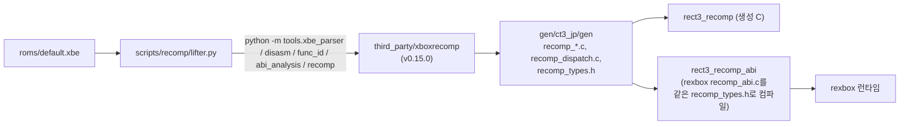
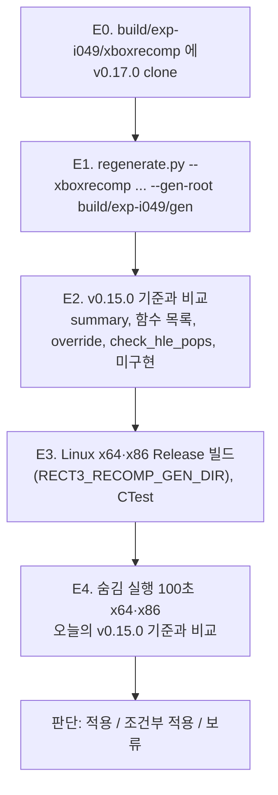

# 설계: xboxrecomp v0.17.0 적용 검토 (issue #49)

작업 지시: [20261110-i049](../work-orders/20261110-i049-xboxrecomp-v0.17.md) · 선례: reJSRF #115(xboxrecomp v0.16.0)

## 1. 요구사항

`third_party/xboxrecomp`는 upstream v0.15.0(`6376eb8`)에 고정돼 있다. upstream 최신은 v0.17.0(`343b6d8`, 140커밋 뒤)이다. 이것을 적용할지 검토한다. 이번 작업은 **검토와 판단**까지다. 고정을 실제로 올리는 일은 판단이 나온 뒤 사용자 결정으로 한다.

## 2. 현재 구조: 이 저장소가 xboxrecomp에 닿는 곳

1. **도구 CLI**: `lifter.py`가 다섯 단계(parse, disasm, func_id, abi, lift)를 인자와 함께 부른다.
2. **출력 형식**: `disasm/functions.json`, `/* ret N */`, `recomp_dispatch.c`, `sub_%08X`·`sub_%08X_gen` 이름. 모두 `lifter.py`가 읽는다.
3. **레지스터 모델과 런타임 함수**: lift 단계가 `recomp_types.h`를 생성 디렉터리에 쓴다. 생성 C는 이 헤더가 선언한 런타임 함수(`recomp_unimpl`, `recomp_icall_fail_log` 등)를 부르고, rexbox의 `recomp_abi.c`가 그것을 정의한다.
4. xboxrecomp의 LGPL 파일은 어떤 타깃의 소스 목록에도 넣지 않는다(AGENTS.md). 생성물은 저장소에 넣지 않는다.

## 3. v0.15.0 → v0.17.0의 변경 중 이 저장소에 닿는 것

| 영역 | 변경 | 영향 | 상태 |
|---|---|---|---|
| CLI | `tools.recomp`의 인자는 그대로다. 미구현 보고 문구만 바뀌었다 | 없음으로 본다 | **추정**, 실험 E1에서 확인 |
| 런타임 함수 | 새 선언은 없다. 미구현 명령 자리는 주석 대신 `RECOMP_UNIMPL` → `recomp_unimpl()` 호출이 된다. 주석(`TODO:`)은 곁에 남는다 | rexbox는 v0.0.11부터 `recomp_unimpl`을 정의한다. CT3의 22곳(`insb`, `hlt`, `outsb`, `cli` 등)이 실행되면 보고된다 | 정의는 **확인됨**(rexbox `src/recomp/recomp_abi.c`). 링크는 E3에서 확인 |
| lift 의미 | 플래그를 호출·`ret`·꼬리 점프 너머로 전달(상대 쪽이 읽을 때), 일반 EBP를 게스트 호출 너머로 공개, CFG가 닿는 블록만 lift, 시프트 횟수 마스크, 정수 소비자의 OF·PF, 좁은 즉치값을 대상 폭으로 읽음, `fnsave`/`frstor`, 빈 슬롯으로 끝나는 switch, coherent 메모리의 `wbinvd` | 원본 동작에 더 가까워지는 수정이다. 지금 잘못 lift된 곳이 있었다면 동작이 바뀐다(#18 같은 드문 멈춤과의 관계는 모른다) | **미확정**, E2·E4로 잰다 |
| 함수 발견(disasm) | gap sweep이 별칭 본문을 통째로 둠, 표 항목 모양, 점프 표 꼬리 바이트 | 함수 경계와 개수가 바뀔 수 있다. HLE override(257개)와 `check_hle_pops.py` 결과가 그대로인지 봐야 한다 | **미확정**, E2 |
| `recomp_types.h` | x86-64 호스트에서 packed SSE/MMX helper가 intrinsic이 된다. 그 밖의 호스트(i386 포함)는 스칼라 기준 구현이다. upstream 테스트가 둘을 비트 단위로 맞춘다. `rcpss`/`rsqrtss`의 호스트 근사는 v0.15.0에도 같았다 | x64 빌드의 성능이 나아질 수 있다. 결과는 같아야 한다 | 비트 일치는 upstream 주장(**추정**). E3의 `rect3_decomp_check`, E4 실행으로 일부 확인 |

선례(**추정**, 다른 프로젝트): reJSRF #115는 v0.16.0에서 함수 9,481 → 9,297, 미해결 스텁 28 → 19, 데모 프레임이 이전과 바이트 단위로 같았다. reEXCEED는 v0.16.0과 rexbox v0.0.26을 쓴다. v0.17.0을 쓰는 형제 프로젝트는 아직 없다.

## 4. 검토 방법

작업 트리의 `gen/ct3_jp`(오늘 v0.15.0으로 생성한 기준)와 submodule checkout은 건드리지 않는다. 실험은 모두 `build/exp-i049/` 아래(git이 무시함)에서 한다.

* **E1 생성**: `python3 scripts/recomp/regenerate.py --xboxrecomp build/exp-i049/xboxrecomp --gen-root build/exp-i049/gen`. 경고·오류, 소요 시간, 남은 파일 경고(`check_checkout_clean`)를 본다.
* **E2 비교**: `recomp-summary/summary.json`(total, translated, failed, total_lines, unresolved_stubs, manual_functions, unimplemented)을 기준과 표로. `disasm/functions.json`의 함수 시작 주소 집합의 차(새로 생김·없어짐, 대표 주소). `hle_overrides.c`의 override 수. `check_hle_pops.py --gen build/exp-i049/gen/ct3_jp`의 불일치 수. decomp 대상 함수(`decomp/`가 대체하는 주소)의 경계가 그대로인지.
* **E3 빌드**: `RECT3_BUILD_DIR=build/exp-i049/build`와 `-DRECT3_RECOMP_GEN_DIR=build/exp-i049/gen/ct3_jp/gen`으로 x64·x86 Release. 경고 수, CTest(특히 `rect3_decomp_check`).
* **E4 실행**: 저장소 루트에서 `REXBOX_DISPLAY=hidden REXBOX_AUDIO=none REXBOX_WATCHDOG=100 REXBOX_D3D8_PROFILE=600`(x86은 `SDL_VIDEO_DRIVER=x11`). 종료 코드, 멈춤·stall·`no target`, `recomp_unimpl` 보고, 타이틀·3D 데모의 fps·CPU·draws를 오늘의 v0.15.0 기준(작업 로그 i025 후속)과 비교한다. 순서대로 하나씩 돌린다.
* 이 실기에서 하지 못하는 것: 생성 코드가 있는 Win32 빌드와 실행(기본 플랫폼). 판단이 '적용'이면 고정을 올리는 작업에서 Windows 기계로 확인한다.

## 5. 판단 기준

* **적용**: E1 오류 0, E3 경고 0·CTest 전부 통과, E2의 함수 변화가 설명되고 override·`check_hle_pops` 불일치가 늘지 않으며, E4가 기준과 같은 수준(멈춤 없음, 새 `recomp_unimpl` 보고 없음, 3D 데모 도달)일 때.
* **조건부 적용**: 위를 막는 원인이 이 저장소나 rexbox의 작은 수정으로 풀릴 때. 그 수정을 설계에 더하고 rexbox 몫은 rexbox issue로 한다.
* **보류**: upstream의 결함으로 막힐 때. 원인을 기록하고 upstream에 알릴 후보로 남긴다.

---

# Design: reviewing xboxrecomp v0.17.0 (issue #49)

Work order: [20261110-i049](../work-orders/20261110-i049-xboxrecomp-v0.17.md) · Precedent: reJSRF #115 (xboxrecomp v0.16.0)

## 1. Requirement

`third_party/xboxrecomp` is pinned at upstream v0.15.0 (`6376eb8`); upstream's latest is v0.17.0 (`343b6d8`, 140 commits later). Review whether to adopt it. This task goes as far as **the review and a verdict**; moving the pin is done afterwards, on the user's decision.

## 2. Current structure: where this repository touches xboxrecomp

The diagram above applies. (1) **Tool CLI**: `lifter.py` runs five steps (parse, disasm, func_id, abi, lift) with their arguments. (2) **Output formats**: `disasm/functions.json`, `/* ret N */`, `recomp_dispatch.c`, the `sub_%08X` and `sub_%08X_gen` names, all read by `lifter.py`. (3) **Register model and runtime functions**: the lift step writes `recomp_types.h` into the generated directory; the generated C calls the runtime functions that header declares (`recomp_unimpl`, `recomp_icall_fail_log` and the rest), and rexbox's `recomp_abi.c` defines them. (4) xboxrecomp's LGPL files go into no target's source list (AGENTS.md), and nothing generated goes into the repository.

## 3. What changes between v0.15.0 and v0.17.0 for this repository

* **CLI**: `tools.recomp` keeps its arguments; only the wording of the unimplemented report changes. No effect expected (**inferred**, checked in E1).
* **Runtime functions**: no new declarations. An unimplemented instruction becomes a `RECOMP_UNIMPL` → `recomp_unimpl()` call instead of a comment, with the `TODO:` comment kept beside it. rexbox defines `recomp_unimpl` since v0.0.11 (**confirmed**, rexbox `src/recomp/recomp_abi.c`); CT3's 22 sites (`insb`, `hlt`, `outsb`, `cli` and the rest) are reported when executed. The link is checked in E3.
* **Lift semantics**: flags carried across calls, `ret`s and tail jumps whose far side reads them; general EBP published across guest calls; only CFG-reachable blocks lifted; shift counts masked; OF and PF for integer consumers; narrow immediates read at the destination's width; `fnsave`/`frstor`; a switch ended by a null slot; `wbinvd` on coherent memory. These bring the lifted code closer to the original; wherever something was lifted wrongly so far, behavior changes (the relation to rare stops such as #18 is unknown). **Unresolved**, measured in E2 and E4.
* **Function discovery (disasm)**: the gap sweep keeps alias bodies whole, table-entry shapes, jump-table tail bytes. Function boundaries and counts may move; the HLE overrides (257) and `check_hle_pops.py` must stay as they are. **Unresolved**, E2.
* **`recomp_types.h`**: on x86-64 hosts the packed SSE/MMX helpers become intrinsics; every other host (i386 included) keeps the scalar reference, and upstream tests match the two bit for bit. The host approximation of `rcpss`/`rsqrtss` was the same in v0.15.0. The x64 build may get faster; results must stay the same. Bit equality is upstream's claim (**inferred**), partly checked by `rect3_decomp_check` in E3 and the runs in E4.

Precedent (**inferred**, another project): with v0.16.0 reJSRF #115 went from 9,481 to 9,297 functions and from 28 to 19 unresolved stubs, with demo frames byte-identical to before. reEXCEED uses v0.16.0 with rexbox v0.0.26. No sibling project uses v0.17.0 yet.

## 4. Review method

The working tree's `gen/ct3_jp` (today's v0.15.0 baseline) and the submodule checkout are not touched; every experiment lives under `build/exp-i049/` (ignored by git), in the order of the second diagram. **E1, generation**: `python3 scripts/recomp/regenerate.py --xboxrecomp build/exp-i049/xboxrecomp --gen-root build/exp-i049/gen`, watching errors, warnings, time and the leftover-file warning (`check_checkout_clean`). **E2, comparison**: a table of `recomp-summary/summary.json` (total, translated, failed, total_lines, unresolved_stubs, manual_functions, unimplemented) against the baseline; the difference of the function start-address sets in `disasm/functions.json` (added and removed, with examples); the override count in `hle_overrides.c`; the mismatches of `check_hle_pops.py --gen build/exp-i049/gen/ct3_jp`; whether the boundaries of the functions `decomp/` replaces stay the same. **E3, build**: x64 and x86 Release with `RECT3_BUILD_DIR=build/exp-i049/build` and `-DRECT3_RECOMP_GEN_DIR=build/exp-i049/gen/ct3_jp/gen`; warning counts and CTest (`rect3_decomp_check` above all). **E4, runs**: from the repository root with `REXBOX_DISPLAY=hidden REXBOX_AUDIO=none REXBOX_WATCHDOG=100 REXBOX_D3D8_PROFILE=600` (`SDL_VIDEO_DRIVER=x11` for x86), one at a time; exit code, stops, stalls, `no target`, `recomp_unimpl` reports, and title and 3D-demo fps, CPU and draws against today's v0.15.0 baseline (work log i025, follow-up). Not possible on this machine: a Win32 build with generated code and its run (the primary platform); with an "adopt" verdict, the pin-moving task checks it on a Windows machine.

## 5. Verdict criteria

* **Adopt**: E1 without errors; E3 with 0 warnings and every CTest test passing; E2's function changes explained, with no more override or `check_hle_pops` mismatches; E4 at the baseline's level (no stop, no new `recomp_unimpl` report, the 3D demo reached).
* **Adopt with changes**: what blocks the above is solved by a small change here or in rexbox; the change joins the design, rexbox's share as a rexbox issue.
* **Wait**: blocked by an upstream defect; the cause is recorded as a candidate to report upstream.
