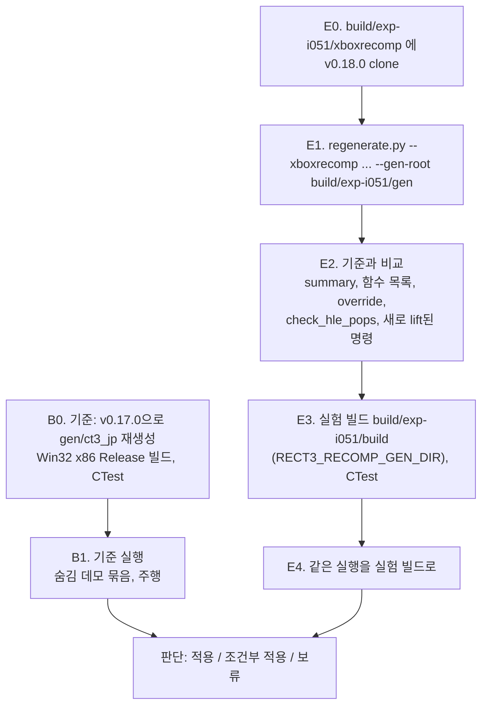

# 설계: xboxrecomp v0.18.0 적용 검토 (issue #51)

작업 지시: [20261123-i051](../work-orders/20261123-i051-xboxrecomp-v0.18.md) · 이전: [i049 v0.17.0](20261110-i049-xboxrecomp-v0.17.md)

## 1. 요구사항

`third_party/xboxrecomp`는 upstream v0.17.0(`343b6d8`, #49)에 고정돼 있다. upstream 최신은 v0.18.0("Wrong Grain", `37b61d5`)이다. 이것을 적용할지 검토한다. 이번 작업은 **검토와 판단**까지이고, 고정을 올리는 일은 판단 뒤 사용자 결정으로 한다.

함께 닫을 일: #49는 생성 코드가 있는 Win32 x86 빌드와 실행을 Windows 기계에서 확인하는 일을 남겼다. 이번 검토의 기준(v0.17.0)을 Windows에서 생성하고 실행하므로 그 확인이 된다.

## 2. 이 저장소가 xboxrecomp에 닿는 곳

[i049 설계 §2](20261110-i049-xboxrecomp-v0.17.md)와 같다. `scripts/recomp/lifter.py`가 도구 CLI 다섯 단계(parse, disasm, func_id, abi, lift)를 부르고, 출력(`functions.json`, `recomp_dispatch.c`, `sub_%08X` 이름)을 읽는다. 생성 C는 `recomp_types.h`의 런타임 함수를 부르고, rexbox의 `recomp_abi.c`가 그것을 정의한다. xboxrecomp의 `src/`(커널, APU, nv2a)는 쓰지 않는다.

## 3. v0.17.0 → v0.18.0의 변경 중 이 저장소에 닿는 것

| 영역 | 변경 | 영향 | 상태 |
|---|---|---|---|
| lift 의미 | 사라지던 명령이 lift된다. xmm 정수 비트 연산(`pand`, `por`, `pxor`, `pcmpgtd` 등), xmm의 `movq`, x87 스택 포인터 명령이다(#329). FCMOV의 캐리 추적(#314). 인라인 표 뒤로 떨어지는 직접 점프의 재동기(#275). 좁은 DIV/IDIV는 머지됐다가 되돌려졌다(#315) | CT3가 이 명령을 쓰면 v0.17.0 출력에서는 빠져 있었다. 동작이 바뀔 수 있다(원본에 가까워지는 방향). #18·`000C967E`의 null 호출과의 관계는 모른다 | **미확정**, E2·E4 |
| 함수 발견 | 시드가 "not_function"을 표시할 수 있다. 1번 칸부터 색인하는 점프 표. 관찰된 시드를 캐시 키에 넣는다 | 함수 경계와 개수가 바뀔 수 있다. HLE override(257개)와 `check_hle_pops.py`를 본다 | **미확정**, E2 |
| `recomp_types.h` | x87 초월 함수가 `recomp_sin` 등을 지난다. `RECOMP_PORTABLE_MATH`를 정하지 않으면 inline libm이다. `PCMPGTD` 등 xmm 매크로가 더해진다 | 기본 설정에서는 새 런타임 함수가 필요 없다. rexbox `recomp_abi.c`가 같은 헤더로 빌드되는지 본다 | **추정**, E3 |
| CLI | `abi_analysis --output`이 맨 파일 이름을 받는다. 그 밖은 그대로로 보인다 | 없음으로 본다 | **추정**, E1 |

## 4. 검토 방법

실험은 모두 `build/exp-i051/` 아래(git이 무시함)에서 한다. 작업 트리의 submodule checkout은 v0.17.0 그대로 둔다.

* **B0 기준**: `python scripts\recomp\regenerate.py`(v0.17.0 고정)로 `gen/ct3_jp`를 다시 만든다. `.\scripts\build_win32_x86.ps1 -Configuration Release`, CTest. #49가 남긴 Windows 확인이다.
* **B1 기준 실행**: 숨긴 어트랙트 데모 6개 동시 실행 2묶음(`%TEMP%\rect3-lead\stress.ps1`)과 West Coast 주행 한 번(`REXBOX_D3D8_SLOW_FRAME=20`, `REXBOX_D3D8_PROFILE=600`). 멈춤·stall·null 호출·`recomp_unimpl`·잠금 시한, 밀집 구간의 fps·cpu를 기록한다.
* **E1 생성**: `--xboxrecomp build/exp-i051/xboxrecomp --gen-root build/exp-i051/gen`. 경고·오류, 소요 시간을 본다.
* **E2 비교**: `recomp-summary/summary.json`(total, translated, failed, total_lines, unresolved_stubs, manual_functions, unimplemented)을 표로 만든다.
  * 함수 시작 주소 집합의 차(새로 생김·없어짐, 대표 주소).
  * `hle_overrides.c`의 override 수, `check_hle_pops.py`의 불일치 수.
  * decomp 대상 함수의 경계가 그대로인지.
  * **새로 lift된 명령**: 생성 C를 기준과 함수 단위로 비교한다. 바뀐 함수 수를 세고, #329(xmm 정수 비트 연산, `movq`, x87 스택 포인터), FCMOV, 재동기 때문에 바뀐 곳을 분류한다. 대표 주소와 원래 명령을 적는다.
* **E3 빌드**: `-DRECT3_RECOMP_GEN_DIR=build/exp-i051/gen/ct3_jp/gen`으로 별도 빌드 트리 `build/exp-i051/build`에 Win32 x86 Release를 빌드한다. 경고 수, CTest(특히 `rect3_decomp_check`)를 본다.
* **E4 실행**: B1과 같은 실행을 실험 빌드로 한다. 결과를 기준과 나란히 적는다.

## 5. 판단 기준

* **적용**: 아래를 모두 만족할 때.
  * E1 오류 0, E3 경고 0·CTest 전부 통과.
  * E2의 함수 변화가 설명되고, override·`check_hle_pops` 불일치가 늘지 않는다.
  * E4가 기준과 같은 수준이다. 새 멈춤·`recomp_unimpl`·null 호출이 없고, 주행에 도달하며, 밀집 구간 fps가 같은 수준이다.
* **조건부 적용**: 위를 막는 원인이 이 저장소나 rexbox의 작은 수정으로 풀릴 때. 그 수정을 설계에 더하고, rexbox 몫은 rexbox issue로 한다.
* **보류**: upstream의 결함으로 막힐 때. 원인을 기록하고 upstream에 알릴 후보로 남긴다.

---

# Design: reviewing xboxrecomp v0.18.0 (issue #51)

Work order: [20261123-i051](../work-orders/20261123-i051-xboxrecomp-v0.18.md) · Earlier: [i049 v0.17.0](20261110-i049-xboxrecomp-v0.17.md)

## 1. Requirement

`third_party/xboxrecomp` is pinned at upstream v0.17.0 (`343b6d8`, #49); upstream's latest is v0.18.0 ("Wrong Grain", `37b61d5`). Review whether to adopt it. This task goes as far as **the review and a verdict**; moving the pin follows on the user's decision.

Closed along the way: #49 left open the Win32 x86 build and run with generated code on a Windows machine. This review generates and runs its v0.17.0 baseline on Windows, which is that check.

## 2. Where this repository meets xboxrecomp

As in [i049 design section 2](20261110-i049-xboxrecomp-v0.17.md): `scripts/recomp/lifter.py` calls the five tool CLI stages (parse, disasm, func_id, abi, lift) and reads their output (`functions.json`, `recomp_dispatch.c`, the `sub_%08X` names). The generated C calls the runtime functions of `recomp_types.h`, which rexbox's `recomp_abi.c` defines. xboxrecomp's `src/` (kernel, APU, nv2a) is not used.

## 3. What in v0.17.0 → v0.18.0 reaches this repository

| Area | Change | Effect | Status |
|---|---|---|---|
| Lift semantics | Instructions that vanished now lift: xmm integer bitwise ops (`pand`, `por`, `pxor`, `pcmpgtd` and so on), `movq` on xmm, x87 stack-pointer ops (#329). FCMOV carry tracking (#314). Direct jumps that land past inline tables resync (#275). Narrow DIV/IDIV was merged and then reverted (#315) | Where CT3 uses these instructions, v0.17.0's output left them out, so behavior may change (towards the original). The relation to the null calls of #18 and `000C967E` is unknown | **Open**, E2 and E4 |
| Function discovery | Seeds can mark "not_function"; jump tables indexed from slot 1; observed seeds in the cache key | Function bounds and counts may change; check the HLE overrides (257) and `check_hle_pops.py` | **Open**, E2 |
| `recomp_types.h` | The x87 transcendentals go through `recomp_sin` and friends, inline libm unless `RECOMP_PORTABLE_MATH` is defined; xmm macros such as `PCMPGTD` are added | No new runtime function by default; check that rexbox's `recomp_abi.c` builds against the same header | **Inferred**, E3 |
| CLI | `abi_analysis --output` accepts a bare file name; the rest looks unchanged | Taken to be none | **Inferred**, E1 |

## 4. Method

Every experiment runs under `build/exp-i051/` (ignored by git); the working tree's submodule checkout stays at v0.17.0.

* **B0 baseline**: regenerate `gen/ct3_jp` with `python scripts\recomp\regenerate.py` (the v0.17.0 pin), `.\scripts\build_win32_x86.ps1 -Configuration Release`, CTest. This is the Windows check #49 left open.
* **B1 baseline runs**: two batches of six hidden attract demos in parallel (`%TEMP%\rect3-lead\stress.ps1`) and one West Coast drive (`REXBOX_D3D8_SLOW_FRAME=20`, `REXBOX_D3D8_PROFILE=600`), recording stops, stalls, null calls, `recomp_unimpl`, lock timeouts, and the dense stretches' fps and CPU.
* **E1 generation**: `--xboxrecomp build/exp-i051/xboxrecomp --gen-root build/exp-i051/gen`, noting warnings, errors and the time taken.
* **E2 comparison**: a table of `recomp-summary/summary.json` (total, translated, failed, total_lines, unresolved_stubs, manual_functions, unimplemented).
  * The difference of the function start-address sets (new and gone, with representative addresses).
  * The override count in `hle_overrides.c` and the mismatch count of `check_hle_pops.py`.
  * Whether the decomp targets' bounds stay the same.
  * **Newly lifted instructions**: compare the generated C with the baseline function by function, count the changed functions, and sort the changes into #329 (xmm integer bitwise, `movq`, x87 stack pointer), FCMOV and resync, with representative addresses and the original instructions.
* **E3 build**: Win32 x86 Release in a separate tree `build/exp-i051/build` with `-DRECT3_RECOMP_GEN_DIR=build/exp-i051/gen/ct3_jp/gen`, noting the warning count and CTest (`rect3_decomp_check` in particular).
* **E4 runs**: B1's runs with the experiment build, recorded beside the baseline.

## 5. Verdict criteria

* **Adopt** when all of these hold:
  * E1 has no errors; E3 has no warnings and passes all of CTest;
  * E2's function changes are explained, and the overrides and `check_hle_pops` mismatches do not grow;
  * E4 matches the baseline: no new stops, `recomp_unimpl` or null calls, gameplay is reached, and the dense stretches' fps is at the same level.
* **Adopt with changes** when what blocks this is solved by a small change in this repository or rexbox; the change is added to the design, and rexbox's part goes to a rexbox issue.
* **Hold** when an upstream defect blocks it; the cause is recorded as a candidate to report upstream.
