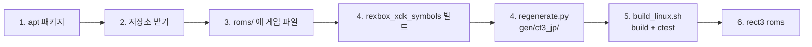

# Linux 개발 환경 준비, 빌드, 실행

근거: [설계 i025](../design/20261025-i025-linux-build.md), [작업 로그 i025](../work-logs/20261025-i025-linux-build.md), rexbox의 [Linux 가이드](../../third_party/rexbox/docs/guides/linux-setup-and-build.md)

Linux x64와 x86(-m32)에서 재컴파일 코드를 생성하고, 게임을 빌드하고 실행한다. Linux 실기(Ubuntu 26.04, GCC 15.2, CMake 4.2, Ninja 1.13, Python 3.14, RTX 4090)에서 생성, x64 빌드와 실행을 확인했고, WSL2(Ubuntu 24.04, GCC 13, CMake 3.28, Ninja 1.11)에서 x64·x86 빌드와 실행을 확인했다. 실기의 x86 빌드는 아직 확인하지 않았다.



## 1. 필요한 것

```bash
sudo apt-get install -y build-essential cmake ninja-build git python3 python3-capstone \
  libasound2-dev libpulse-dev libx11-dev libxext-dev libxcursor-dev libxi-dev libxrandr-dev libxss-dev libxtst-dev \
  libxfixes-dev libxkbcommon-dev libwayland-dev libdecor-0-dev libdrm-dev libgbm-dev libgl-dev libegl-dev
# x86 (-m32) 빌드라면 추가로 같은 개발 패키지의 i386 판:
sudo dpkg --add-architecture i386 && sudo apt-get update
sudo apt-get install -y gcc-multilib g++-multilib \
  libasound2-dev:i386 libpulse-dev:i386 libx11-dev:i386 libxext-dev:i386 libxcursor-dev:i386 libxi-dev:i386 \
  libxrandr-dev:i386 libxss-dev:i386 libxtst-dev:i386 libxfixes-dev:i386 libxkbcommon-dev:i386 libwayland-dev:i386 \
  libdecor-0-dev:i386 libgl-dev:i386 libegl-dev:i386
```

* SDL3는 X11 확장(XScrnSaver, XTest 등)의 개발 패키지가 없으면 configure에서 `Couldn't find dependency package for XSCRNSAVER`처럼 멈춘다. 그 이름의 패키지(x86이면 `:i386`)를 설치한다.
* 창 표시에는 OpenGL 3.3 이상이 필요하다.
* `capstone`은 재컴파일 파이프라인(disasm 단계)이 쓴다. Ubuntu 24.04 이후의 시스템 Python에는 `pip install`이 막혀 있으므로 apt의 `python3-capstone`을 쓴다. 가상 환경을 쓰려면 `python3 -m venv .venv && .venv/bin/pip install capstone` 뒤 `.venv/bin/python`으로 스크립트를 실행한다.
* 직접 소유한 Crazy Taxi 3: High Roller(일본판) 디스크의 덤프가 필요하다.

## 2. 저장소 받기

```bash
git clone --recurse-submodules https://github.com/reexec/reCT3.git
cd reCT3
# submodule 없이 받았다면:
git submodule update --init --recursive
```

## 3. 게임 파일 두기

디스크에서 추출한 파일을 `roms/`에 둔다(`default.xbe`와 `Media/...`). 형식과 추출 도구, 다른 덤프의 XBE 등록은 [Win32 가이드](win32-setup-and-build.md) §3, §4와 같다. 등록 스크립트는 `python3 scripts/recomp/register_xbe.py`로 실행한다.

## 4. 재컴파일 코드 생성 (처음 한 번)

```bash
# XDK 함수 식별 도구를 먼저 빌드한다
cmake --preset linux-x64-release
cmake --build --preset linux-x64-release --target rexbox_xdk_symbols
# gen/ct3_jp/ 에 생성 (12코어에서 약 5분)
python3 scripts/recomp/regenerate.py
```

`regenerate.py`는 `rexbox_xdk_symbols`를 `build/linux-<arch>-<config>`(`RECT3_BUILD_DIR`이 있으면 그 아래도)와 Win32 빌드 트리에서 찾는다. 다른 위치에 있으면 `--symbols-tool <경로>`로 준다. 다른 XBE는 `--xbe <경로>`로 준다. 생성 전에 XBE의 MD5가 등록된 일본판과 같은지 확인하고, 다르면 멈춘다.

생성 코드는 플랫폼 중립 C라서 x64와 x86이 같은 `gen/`을 쓴다. 커밋하지 않으며, `src/game/ct3/decomp/`를 바꾸거나 submodule을 갱신한 뒤에는 다시 생성한다. 생성하지 않아도 빌드는 되지만 앱은 로드 단계에서 멈춘다.

## 5. 빌드와 테스트

```bash
scripts/build_linux.sh x64 release                    # configure + build + ctest
scripts/build_linux.sh x86 release                    # -m32
scripts/build_linux.sh x64 debug --no-test            # Debug, 테스트 생략
# 또는 프리셋을 직접:
cmake --preset linux-x64-release && cmake --build --preset linux-x64-release && ctest --preset linux-x64-release
```

빌드 트리는 `build/linux-<arch>-<config>`이고, `RECT3_BUILD_DIR`을 주면 `$RECT3_BUILD_DIR/linux-<arch>-<config>`다. 실행 파일은 `<빌드 트리>/src/app/rect3`다. 생성 코드가 있으면 CTest가 `rect3_decomp_check`(`<빌드 트리>/tools/`)도 돌린다(7개). SDL3의 Wayland 프로토콜 스캐너가 configure 때 내는 `validity error`(XML DTD)는 무시한다.

## 6. 실행

```bash
mkdir -p ~/ct3run && cd ~/ct3run                      # 게임의 HDD(hdd/: 캐시·세이브)가 여기에 생긴다
~/reCT3/build/linux-x64-release/src/app/rect3 ~/reCT3/roms
# 창 없이 진단만:
REXBOX_DISPLAY=hidden REXBOX_AUDIO=none REXBOX_WATCHDOG=100 REXBOX_D3D8_PROFILE=600 \
  ~/reCT3/build/linux-x64-release/src/app/rect3 ~/reCT3/roms
```

인자는 게임 디렉터리다(위 예는 저장소를 `~/reCT3`에 받은 경우). 게임의 HDD는 현재 폴더의 `hdd/`에 만들어지고 `RECT3_HDD_ROOT`로 바꾼다. 설정은 실행 파일 옆 `rect3.ini`에 저장된다. 환경 변수(`REXBOX_*`), 창 조작, 설정 메뉴는 Win32와 같다([rexbox ARCHITECTURE §5](../../third_party/rexbox/ARCHITECTURE.md)). 처음 실행에서는 타이틀이 캐시 파티션(`hdd/Partition5`)을 채우느라 데모 시작이 늦다. `REXBOX_SAMPLE`(샘플링 프로파일러)은 Linux에서 거부된다.

## 7. WSL2

* Windows 작업 트리를 `/mnt/e/...`처럼 그대로 쓸 수 있다(`gen/`과 `roms/`도 공유). 빌드 트리는 `/mnt` 아래에 두지 않는다(9p 파일 시스템이라 느리다).

  ```bash
  cd /mnt/e/MYWORK/Projects/reCT3                     # Windows 작업 트리
  export RECT3_BUILD_DIR=$HOME/build/reCT3            # 빌드 트리를 Linux 쪽에
  scripts/build_linux.sh x64 release
  ```

* OpenGL이 Mesa llvmpipe(소프트웨어)라 GPU가 없다. 타이틀 화면은 60 fps지만 3D 장면은 x64에서 46 fps, x86에서 그 이하다. 실기 수치가 아니다.
* soft-dirty 페이지 추적이 없어 D3D8이 정점·인덱스 버퍼를 매 프레임 모두 비교한다(정확성은 같다).
* `/mnt` 아래의 디스크 자산 읽기가 느리다.

---

# Linux development setup, build and run

Basis: [design i025](../design/20261025-i025-linux-build.md), [work log i025](../work-logs/20261025-i025-linux-build.md), rexbox's [Linux guide](../../third_party/rexbox/docs/guides/linux-setup-and-build.md)

Generates the recompiled code, builds and runs the game on Linux x64 and x86 (-m32). On a Linux machine (Ubuntu 26.04, GCC 15.2, CMake 4.2, Ninja 1.13, Python 3.14, RTX 4090) the generation and the x64 build and run are checked; on WSL2 (Ubuntu 24.04, GCC 13, CMake 3.28, Ninja 1.11) the x64 and x86 builds and runs. The x86 build on a Linux machine is not checked yet. The diagram above shows the steps.

## 1. Requirements

The apt packages above, `python3-capstone` included (the x86 build adds the i386 architecture, `gcc-multilib`/`g++-multilib` and the `:i386` versions of the development packages). SDL3 stops at configure when an X11 extension's development package is missing (`Couldn't find dependency package for XSCRNSAVER` and the like): install that package (`:i386` for x86). A window needs OpenGL 3.3 or newer. `capstone` is used by the recompilation pipeline (the disasm stage); the system Python of Ubuntu 24.04 and later refuses `pip install`, so take apt's `python3-capstone`, or use a virtual environment (`python3 -m venv .venv && .venv/bin/pip install capstone`, then run the scripts with `.venv/bin/python`). A dump of a Crazy Taxi 3: High Roller (Japan) disc you own is needed.

## 2. Getting the repository

`git clone --recurse-submodules https://github.com/reexec/reCT3.git`, or `git submodule update --init --recursive` after a clone without submodules.

## 3. Game files

Put the files extracted from the disc under `roms/` (`default.xbe` and `Media/...`). The layout, the extraction tools and registering another dump's XBE are as in the [Win32 guide](win32-setup-and-build.md) sections 3 and 4; run the registration script as `python3 scripts/recomp/register_xbe.py`.

## 4. Generating the recompiled code (once)

Configure the preset and build `rexbox_xdk_symbols` first (`cmake --preset linux-x64-release`, `cmake --build --preset linux-x64-release --target rexbox_xdk_symbols`), then run `python3 scripts/recomp/regenerate.py` (into `gen/ct3_jp/`, about 5 minutes on 12 cores). `regenerate.py` looks for `rexbox_xdk_symbols` in `build/linux-<arch>-<config>` (and under `RECT3_BUILD_DIR` when it is set) and in the Win32 tree; `--symbols-tool <path>` names any other place, `--xbe <path>` another XBE. It checks that the XBE's MD5 is the registered Japan build's before generating, and stops otherwise. The generated code is platform-neutral C, so x64 and x86 share one `gen/`. It is never committed; regenerate after changing `src/game/ct3/decomp/` or moving a submodule. Without it the build still succeeds, but the app stops at load.

## 5. Build and test

`scripts/build_linux.sh x64 release` (or `x86`, `debug`, `--no-test`) configures, builds and runs `ctest`; the presets also work directly (`cmake --preset linux-x64-release` and so on). The tree is `build/linux-<arch>-<config>`, or `$RECT3_BUILD_DIR/linux-<arch>-<config>` when that is set. The executable is `<tree>/src/app/rect3`; with generated code CTest also runs `rect3_decomp_check` (`<tree>/tools/`; seven tests in all). The `validity error` lines from SDL3's Wayland protocol scanner at configure time (XML DTD) are harmless.

## 6. Run

Run from a directory of your own with the game directory as the argument, as in section 6 above: the game's hard disk is created under `hdd/` in the current directory (`RECT3_HDD_ROOT` moves it), and settings are saved in `rect3.ini` next to the executable; `REXBOX_DISPLAY=hidden REXBOX_AUDIO=none REXBOX_WATCHDOG=100` gives a diagnostic run without a window. The `REXBOX_*` variables, the window and the settings menu are the same as on Win32 ([rexbox ARCHITECTURE section 5](../../third_party/rexbox/ARCHITECTURE.md)). On the first run the title fills the cache partition (`hdd/Partition5`), which delays the demo. `REXBOX_SAMPLE` (the sampling profiler) is refused on Linux.

## 7. WSL2

The Windows working tree can be used as it is through `/mnt/e/...` (`gen/` and `roms/` shared), with the build tree kept off `/mnt` (9p is slow) through `RECT3_BUILD_DIR`, as in the commands above. OpenGL is Mesa llvmpipe, so there is no GPU: the title screen runs at 60 fps, 3D scenes at 46 fps on x64 and less on x86, none of it a real machine's numbers. Without soft-dirty page tracking D3D8 compares every vertex and index buffer each frame (same correctness). Disc asset reads under `/mnt` are slow.
