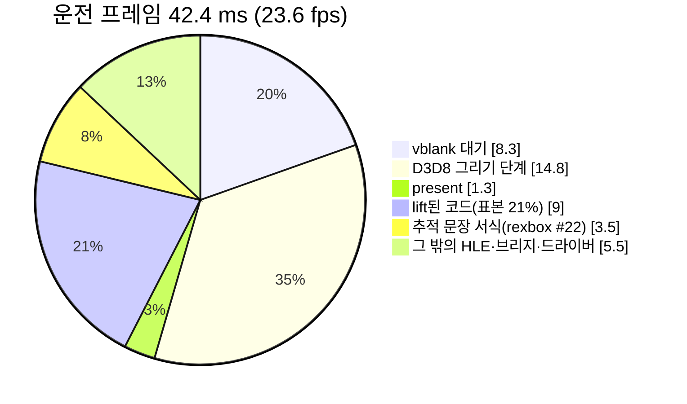

# 작업 로그: 운전 화면의 프레임 시간 — 측정과 설계 (issue #17)

작업 지시: [20261021-i017-driving-frame-time](../work-orders/20261021-i017-driving-frame-time.md) · rexbox: issue #22([작업 로그](../../third_party/rexbox/docs/work-logs/20261021-i022-trace-text-off-path.md)), issue #23([설계](../../third_party/rexbox/docs/design/20261021-i023-draw-cpu-cost.md))

## 한 일

1. 입력 자동화: `scripts/drive_west_coast.ps1`이 `REXBOX_INPUT=keyboard`로 게임을 띄우고 게임 창에 `WM_KEYDOWN`/`WM_KEYUP`을 보내 West Coast 운전까지 간다. 환경 변수는 게임 프로세스에만 준다(한 PowerShell 세션에서 `$env:`를 바꿔 실행을 이으면 앞 실행의 변수가 남아 측정 세 개가 무효였다). 절차: [가이드](../guides/driving-measurement.md).
2. 측정(i5-7200U + HD 620, 창 1280×960, Release, 운전 구간 120 present 평균, 두 실행 A·B):

| 부분 | ms/프레임 | 세부 |
|---|---|---|
| vblank 대기 | 8.3 | 바쁜 시간 약 33 ms가 vblank 둘을 넘나들어 프레임이 vblank 2~3개(양자화) |
| D3D8 그리기 | 14.8 | 그리기 약 810개: setup 4.0, constants 2.9, indices 2.1, upload 1.7, attributes 1.4, state 1.1, textures 0.9, draw 0.4, target 0.3 |
| present | 1.3 | SwapBuffers 포함 |
| other | 17.9 | lift된 코드 약 9 ms(행렬 함수 `sub_000E4CB7`·`sub_000E4BB9`·`sub_000E4B73`이 앞), ucrtbase 13.2%(printf 7.1%), `NtWriteFile` 2.6%, 할당 1.5% |
| 표시 스레드 CPU | 29~30 | |

3. CPU와 GPU: 표시 스레드 표본(present 2500~3200)은 sleep 20%, D3D8 HLE 21%, lift된 코드 21%, ucrtbase 13%, GL 드라이버 6%다. present가 1.3 ms이므로 GPU·present 대기는 작다. 비용은 CPU이고 표시 스레드 하나에 몰려 있다.
4. 비교(같은 시점의 기준 F와): vsync 끔 63.0 ms, 숨긴 창 60.0, 렌더 배율 2 61.2, 기준 59.0 — 차이 없음. 프레임 덤프는 `REXBOX_FRAME_DUMP`에 적은 프레임에서만 일어나고 기본은 꺼져 있다. 같은 바이너리의 기준 실행이 23.5 → 16.9 → 27.3 fps로 흔들려, 빌드 비교는 번갈아 바로 이은 짝으로 했다.
5. 작은 수정(rexbox #22): ucrtbase의 뜨거운 주소를 역어셈블해 printf 서식 해석·자릿수 생성·`fegetround`임을 확인했고, 호출처는 객체마다 불리는 `SetModelView`(`%g` 다섯 개와 추적용 행렬 곱)와 `SetVertexShaderInput`의 추적 문장이었다. 추적이 켜졌을 때만 만들게 했다. submodule을 rexbox 작업 브랜치 `i022-trace-text-off-path`의 커밋 `30a97b0`으로 올렸다(push 전, 임시).
6. 가장 큰 비용의 설계(rexbox #23): 그리기 하나에 약 18 µs. 앞 그리기 이후 바뀐 것만 하도록 그리기 상태 메모, 위치 색인 uniform 캐시와 버전, 인덱스 재사용 버퍼, 프레임 내 정점 비교 생략, 범위별 VAO. 기대 약 33 → 21 ms(30 fps 고정, 게임 0.5배, **추정**). 60 fps에는 렌더 스레드가 다음 단계다.

## 검증

| 검증 | 결과 |
|---|---|
| Win32 x86 Release, CTest | 오류 0, reCT3 5/5, rexbox 3/3 |
| #22 표본 비율(같은 구간) | ucrtbase 13.2% → 2.7%, 프레임당 표본 20.5 → 17.3 |
| #22 짝 실행(H 기준 → G2 수정) | `other` 15.6 → 12.1 ms, CPU 27.2 → 24.7 ms, 27.3 → 28.4 fps |
| `scripts/drive_west_coast.ps1` | 운전까지 감(draws 806~812), 끝난 뒤 `REXBOX_INPUT`·`REXBOX_D3D8_PROFILE`이 남지 않음 |

## 남은 것

* rexbox #23 구현(설계만 했다). 그 뒤 렌더 스레드 설계.
* 어트랙트 데모 중 드문 정지: `000C11B1`의 `call [eax+0x18]`이 0을 불러 건너뛰고 멈춘다(수정 빌드 6회 중 2회, 기준 11회 중 0회). 스레드 경합으로 **추정**(분석 §7).
* 표시 스레드의 `NtWriteFile`(프레임당 약 0.9 ms)의 출처(분석 §7).
* rexbox 작업 브랜치는 push하지 않았다. 머지 요청이 오면 rexbox #22를 머지하고 submodule을 머지된 커밋으로 고정한다.

---

# Work log: frame time while driving — measurement and design (issue #17)

Work order: [20261021-i017-driving-frame-time](../work-orders/20261021-i017-driving-frame-time.md) · rexbox: issue #22 ([work log](../../third_party/rexbox/docs/work-logs/20261021-i022-trace-text-off-path.md)), issue #23 ([design](../../third_party/rexbox/docs/design/20261021-i023-draw-cpu-cost.md))

Done:

1. Input automation: `scripts/drive_west_coast.ps1` starts the game with `REXBOX_INPUT=keyboard` and posts `WM_KEYDOWN`/`WM_KEYUP` to its window to reach West Coast driving, giving the environment variables to the game's process only (chaining runs in one PowerShell session with `$env:` changes carried variables into the next run and spoiled three measurements). Procedure: [guide](../guides/driving-measurement.md).
2. Measurement (i5-7200U + HD 620, 1280×960 window, Release, driving-span averages of 120-present windows, runs A and B): 42.4 ms per frame (23.6 fps) = vblank wait 8.3 ms (a busy time of about 33 ms straddles two vblanks, so frames take two or three: quantization) + D3D8 draw phases 14.8 ms for about 810 draws (setup 4.0, constants 2.9, indices 2.1, upload 1.7, attributes 1.4, state 1.1, textures 0.9, draw 0.4, target 0.3) + present 1.3 ms (including SwapBuffers) + other 17.9 ms (lifted code about 9 ms led by the matrix functions `sub_000E4CB7`, `sub_000E4BB9` and `sub_000E4B73`; ucrtbase 13.2% of samples, 7.1% of it printf; `NtWriteFile` 2.6%; allocation 1.5%). The presenting thread uses 29–30 ms of CPU per frame.
3. CPU against GPU: the presenting thread's samples (presents 2500–3200) are 20% sleep, 21% D3D8 HLE, 21% lifted code, 13% ucrtbase and 6% GL driver; present is 1.3 ms, so the GPU/present wait is small. The cost is CPU, all on the presenting thread.
4. Comparisons against baseline F made at the same time: vsync off 63.0 ms, hidden window 60.0, render scale 2 61.2, baseline 59.0 — no difference. Frame dumps happen only at frames listed in `REXBOX_FRAME_DUMP` and are off by default. Baseline runs of one binary swung from 23.5 to 16.9 to 27.3 fps, so builds were compared in alternating back-to-back pairs.
5. The small fix (rexbox #22): disassembling ucrtbase's hot addresses showed printf's format parser, digit generation and `fegetround`; the callers were the trace text of `SetModelView` (five `%g` plus a matrix product for the trace) and `SetVertexShaderInput`, both called per object. They are now built only while tracing. The submodule moved to commit `30a97b0` on the rexbox task branch `i022-trace-text-off-path` (not pushed; temporary).
6. The design for the biggest cost (rexbox #23): about 18 µs per draw. Do only what changed since the previous draw: a draw-state memo, a location-indexed uniform cache with versions, reused index buffers, no second vertex compare within a frame, a VAO per range. Expected about 33 → 21 ms (a steady 30 fps, the game at 0.5×, **inferred**); 60 fps needs a render thread as the next step.

Verification:

| Check | Result |
|---|---|
| Win32 x86 Release, CTest | no errors, reCT3 5/5, rexbox 3/3 |
| #22 sample shares (same span) | ucrtbase 13.2% → 2.7%, samples per frame 20.5 → 17.3 |
| #22 paired runs (baseline H → fixed G2) | `other` 15.6 → 12.1 ms, CPU 27.2 → 24.7 ms, 27.3 → 28.4 fps |
| `scripts/drive_west_coast.ps1` | reaches driving (806–812 draws); `REXBOX_INPUT` and `REXBOX_D3D8_PROFILE` are not left set afterwards |

Left over:

* Implementing rexbox #23 (designed only), then a render-thread design.
* A rare stop in the attract demo: `call [eax+0x18]` at `000C11B1` finds 0 and is skipped, then the run stops (2 of 6 runs of the fixed build, 0 of 11 of the baseline); **inferred** to be a thread race (analysis section 7).
* The source of the presenting thread's `NtWriteFile` (about 0.9 ms per frame; analysis section 7).
* The rexbox task branch is not pushed. On a merge request, rexbox #22 is merged first and the submodule pinned to the merged commit.
