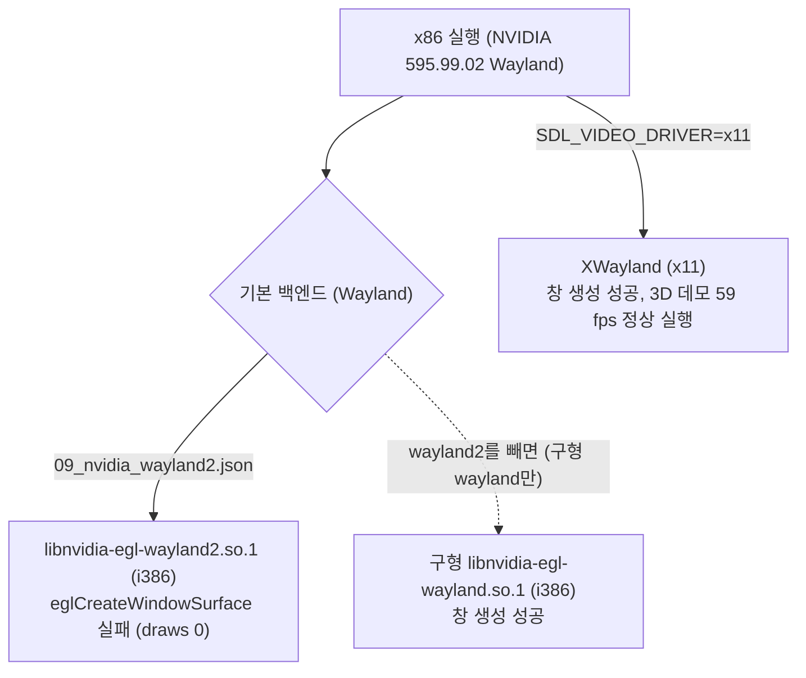

# 작업 로그: Linux x64 / x86 빌드와 첫 실행 — WSL2 완료, 실기 남음 (issue #25)

작업 지시: [20261025-i025-linux-build](../work-orders/20261025-i025-linux-build.md) · 설계: [20261025-i025-linux-build](../design/20261025-i025-linux-build.md) · 가이드: [linux-setup-and-build](../guides/linux-setup-and-build.md)

## 한 일

1. `third_party/rexbox`를 v0.0.12(`a018038`)에서 v0.0.14(`befa752`)로 올렸다. v0.0.13은 Linux GCC 경고 두 개, v0.0.14는 생성 코드 없는 트리의 GNU ld 링크 순서(CI 구성)다. Win32 x86 Release 빌드와 CTest 6/6은 그대로다.
2. `CMakePresets.json`(rexbox와 같은 네 프리셋)과 `scripts/build_linux.sh`(`RECT3_BUILD_DIR`로 빌드 트리를 `/mnt` 밖에 둠).
3. WSL2(Ubuntu 24.04.1, 커널 5.15, GCC 13.3, CMake 3.28, Ninja 1.11, 12코어)에서 x64·x86 Release를 빌드했다. 소스는 Windows 작업 트리(`/mnt/e`), 생성 코드는 Windows에서 만든 `gen/ct3_jp` 그대로다. 둘 다 오류 0, 경고 0(rexbox 포함). 손댄 코드는 없다: lifted C 4,900여 개 함수가 GCC에서 그대로 컴파일됐다.
4. CI에 Linux x64 작업(debug, release)을 더했다. x86은 러너의 i386 패키지 설치 실패(rexbox CI와 같음) 때문에 넣지 않았다.
5. 가이드, README 플랫폼 표, 가이드 색인.

## 검증 (WSL2, llvmpipe 소프트웨어 렌더링)

| 검증 | x64 | x86 (-m32) |
|---|---|---|
| 빌드, CTest | 오류·경고 0, 6/6 | 오류·경고 0, 6/6 |
| 숨김 실행(`REXBOX_WATCHDOG` 100/150초) | 멈춤·`no target`·stall 없음. 타이틀 화면 60.0 fps(CPU 1 ms), 3D 데모 46 fps(CPU 12 ms, draws 644) | 멈춤 없음. 타이틀 60.0 fps, 3D 데모 22~28 fps(CPU 22~31 ms, draws 448~705) |
| 프레임 덤프 4200 | 언덕 위의 택시: 차·잔디 텍스처·자막 정상 | 운전자 소개 카드(망점 처리): Win32의 frame 4200과 같은 종류의 화면, 정상 |
| 캐시 | `hdd/Partition5/_bank10.mdl` 13,115,392바이트(Windows와 같은 크기): 이름 바꾸기 경로가 Linux에서도 동작 | 공유 |
| WSLg 창, 호스트 오디오 | 창 1280x960 OpenGL 3.3, 오디오 48 kHz 스테레오, 게임패드 포트 열림(30초) | 안 함 |

Win32(RTX 4090)와 비교: 60 fps에서 3D 데모는 Win32가 frame 2100~3000 사이, Linux가 3000~3600 사이에 시작한다. `/mnt/e`(9p)의 자산 읽기가 느린 탓으로 **추정**한다. 데모 장면 자체는 타이밍이 달라 같은 프레임의 그림을 직접 비교하지는 못했다. 64비트 호스트에서 lifted 코드는 바뀐 것 없이 돌았다(설계의 위험 항목 해소).

x86 빌드 중에 함께 돌린 x64 실행은 100초 안에 데모에 못 미쳤다(CPU 경쟁). 측정은 혼자 돌릴 때 한다.

## 남은 것

* Linux 실기 확인(GPU 드라이버, soft-dirty 추적이 있는 커널에서의 fps). 이 issue에 이어 붙인다.
* Linux에서 `regenerate.py` 실행은 확인하지 않았다(capstone 설치 필요).
* CI의 Linux 작업은 이 PR에서 처음 돈다.

## 후속: Linux 실기 (2026-10-27)

환경: Ubuntu 26.04.1, 커널 7.0.0(soft-dirty 있음), GCC 15.2, CMake 4.2.3, Ninja 1.13.2, Python 3.14.4, `python3-capstone` 5.0.7(apt), 12코어, RTX 4090(NVIDIA 595.99.02, Wayland 세션).

1. `regenerate.py`가 `rexbox_xdk_symbols not found`로 멈췄다. 후보가 `build/win32_x86`과 `build/third_party/...`뿐이었다. Linux 프리셋 트리 여덟 곳(`RECT3_BUILD_DIR`과 `build/` 아래 `linux-{x64,x86}-{release,debug}`)을 후보에 더했다.
2. 그다음 disasm 단계가 `No module named 'capstone'`으로 멈췄다. Ubuntu의 시스템 Python은 `pip install`을 막으므로(PEP 668) 가이드에 apt의 `python3-capstone`과 venv 방법을 적었다.
3. 생성: XDK 심볼 330개, 4분 55초, 오류·경고 없음. `gen/ct3_jp/gen/recomp_0000.c`~`recomp_0019.c`와 `recomp_dispatch.c`.
4. 빈 트리(`RECT3_BUILD_DIR`)의 x64 Release: 518단계 1분 38초, 경고 0, CTest 7/7(`rect3_decomp_check` 포함).
5. 숨김 실행 100초(`REXBOX_DISPLAY=hidden REXBOX_AUDIO=none REXBOX_WATCHDOG=100 REXBOX_D3D8_PROFILE=600`): 멈춤·stall 없이 워치독(종료 코드 4)까지. OpenGL 3.3 on RTX 4090. 타이틀 화면 60.0 fps(CPU 0.5~1.5 ms), 3D 데모 59.0~59.1 fps(CPU 3.7~4.5 ms, draws 552~759). 셰이더를 처음 컴파일하는 구간은 34~52 fps(프로그램 130개, 2.8초). 캐시 `hdd/Partition5/_bank10.mdl` 13,115,392바이트(Windows·WSL2와 같다).
6. x86 Release는 configure에서 멈췄다: SDL3가 `XSCRNSAVER`, `XTEST`의 i386 개발 패키지를 찾지 못했다(`libxss-dev:i386`, `libxtst-dev:i386` 미설치). 두 옵션을 끄고 configure하면 통과하므로 빠진 것은 이 둘뿐이다. 가이드의 x86 패키지 목록을 x64 목록의 i386 판으로 바꾸고, x64 목록에도 CI에 있던 `libxtst-dev`를 더했다.
7. `scripts/build_linux.sh`를 git에서 100755로 바꿨다.
8. rexbox의 `hle_overrides.py`가 내는 `not found` 안내는 Win32 명령만 적는다. rexbox 쪽 문구이므로 여기서는 고치지 않는다.

남은 것: 실기의 x86 빌드와 실행(i386 패키지 설치 뒤), 실기의 창·오디오·게임패드 확인.

## 후속: 실기의 x86 (2026-11-10)

역할 분담: 총괄·설계·리뷰는 Claude, 구현은 Antigravity.

환경: Ubuntu 26.04, 커널 7.0.0-43, GCC 15.2.0, CMake 4.2.3, Ninja 1.13.2, Python 3.14.4, 12코어, RTX 4090(NVIDIA 595.99.02, Wayland 세션). 원격 최신 main v0.0.24, rexbox 682cdaf(v0.0.30), xboxrecomp v0.15.0.

1. `regenerate.py`: XDK 심볼 330개, 4,931/4,932 함수(실패 0), 717,737줄, 소스 20개, 약 5분.
2. x64 Release: 경고 0, CTest 7/7. 숨김 100초 실행: 종료 코드 4(워치독), 멈춤·stall 없음, 타이틀 화면 60.0 fps(CPU 0.7~1.8 ms), 3D 데모 59.5~59.9 fps(CPU 4.1~5.5 ms, draws 590~949).
3. x86 Release: 첫 configure는 SDL3가 `Couldn't find dependency package for XSCRNSAVER`로 멈췄다(`libxss-dev:i386`, `libxtst-dev:i386` 미설치). 설치 중 `libxtst-dev:i386`이 man 페이지 덮어쓰기 오류(`trying to overwrite shared '/usr/share/man/man3/XTestQueryExtension.3.gz' ...`; i386·amd64 판 man 페이지 11개가 다른 docbook-xsl로 생성되어 다름, 헤더는 같음)로 실패하여 `--force-overwrite`로 설치했다. 빈 트리 빌드는 526단계, 경고 0, CTest 7/7.
4. x86 숨김 100초(기본): 종료 코드 4, 하지만 `cannot open the display: SDL_CreateWindow failed: unable to create an EGL window surface`가 나고 draws 0 내내. 실험(각 12~15초): 기본·`__EGL_VENDOR_LIBRARY_FILENAMES=10_nvidia.json` → 실패, `SDL_VIDEO_DRIVER=x11` → 성공, `__EGL_EXTERNAL_PLATFORM_CONFIG_FILENAMES`로 wayland2만 → 실패, 구형 wayland만 → 성공, x64에서 wayland2만 → 성공. 결론: i386 `libnvidia-egl-wayland2.so.1`(1.0.1)의 `eglCreateWindowSurface` 실패(**확인됨**).
5. x86 숨김 100초(`SDL_VIDEO_DRIVER=x11`): 종료 코드 4, 멈춤·stall 없음, OpenGL 3.3 RTX 4090, 타이틀 화면 60.0 fps(CPU 1.1~2.6 ms), 3D 데모 58.5~59.9 fps(CPU 6.0~7.4 ms, draws 571~923, 첫 장면 진입 구간 53.9 fps).
6. 관찰: x86은 x64가 저장한 셰이더 프로그램 바이너리 캐시를 1024개 중 1021개 거부했다(warmed 3, refused 1021). 드라이버가 다른 아키텍처의 바이너리를 거부한 것으로 **추정**한다. 다시 컴파일하므로 정확성 영향 없음.

남은 것: 실기의 창·오디오·게임패드 확인(사용자). rexbox 자동 폴백은 하지 않음(설계 §6).

---

# Work log: Linux x64 / x86 build and first run — WSL2 done, a Linux machine left (issue #25)

Work order: [20261025-i025-linux-build](../work-orders/20261025-i025-linux-build.md) · Design: [20261025-i025-linux-build](../design/20261025-i025-linux-build.md) · Guide: [linux-setup-and-build](../guides/linux-setup-and-build.md)

Done: `third_party/rexbox` moved from v0.0.12 (`a018038`) to v0.0.14 (`befa752`; v0.0.13 removes two Linux GCC warnings, v0.0.14 fixes the GNU ld link order of a tree without generated code, the CI configuration), with the Win32 x86 Release build and CTest 6/6 unchanged. `CMakePresets.json` (rexbox's four presets) and `scripts/build_linux.sh` (`RECT3_BUILD_DIR` keeps the tree off `/mnt`). On WSL2 (Ubuntu 24.04.1, kernel 5.15, GCC 13.3, CMake 3.28, Ninja 1.11, 12 cores) the x64 and x86 Release builds, from the Windows working tree (`/mnt/e`) and the `gen/ct3_jp` generated on Windows, both have 0 errors and 0 warnings (rexbox included); no code was touched: the 4,900-odd lifted C functions compile under GCC as they are. CI gains a Linux x64 job (debug, release); x86 is left out because the runner's i386 package install fails (as in rexbox's CI). Guide, README platform table and guide index.

Verification (WSL2, llvmpipe software rendering): x64 and x86 build with 0 errors and warnings and CTest 6/6. Hidden runs (`REXBOX_WATCHDOG` 100/150 s) have no stop, `no target` or stall: x64 shows the title screen at 60.0 fps (1 ms CPU) and the 3D demo at 46 fps (12 ms CPU, 644 draws); x86 the title at 60.0 fps and the demo at 22–28 fps (22–31 ms CPU, 448–705 draws). Frame 4200 dumps are correct on both: on x64 the taxi on a hill with its grass texture and caption, on x86 a halftoned driver intro card (the same kind of screen as Win32's frame 4200). The cache `hdd/Partition5/_bank10.mdl` is 13,115,392 bytes (the Windows size), so the rename path works on Linux. A WSLg window run on x64 opens a 1280x960 OpenGL 3.3 window, host audio at 48 kHz stereo and a gamepad port (30 s). Against Win32 (RTX 4090) at 60 fps the 3D demo starts between frames 2100 and 3000 on Win32 and 3000 and 3600 on Linux, **inferred** to be the slow asset reads over `/mnt/e` (9p); the demo's timing differs, so the same frame's picture was not compared directly. The lifted code ran unchanged on a 64-bit host (the design's risk resolved). An x64 run made while the x86 build was running did not reach the demo in 100 s (CPU contention); measurements are taken alone.

Left open: the Linux-machine check (GPU driver, fps on a kernel with soft-dirty tracking), appended to this issue; `regenerate.py` on Linux is not verified (capstone needed); the CI Linux job runs for the first time on this pull request.

## Follow-up: a Linux machine (2026-10-27)

Machine: Ubuntu 26.04.1, kernel 7.0.0 (soft-dirty available), GCC 15.2, CMake 4.2.3, Ninja 1.13.2, Python 3.14.4, `python3-capstone` 5.0.7 (apt), 12 cores, RTX 4090 (NVIDIA 595.99.02, a Wayland session).

`regenerate.py` stopped with `rexbox_xdk_symbols not found`: the candidates were only `build/win32_x86` and `build/third_party/...`. The eight Linux preset trees (`linux-{x64,x86}-{release,debug}` under `RECT3_BUILD_DIR` and `build/`) joined the candidates. The disasm stage then stopped with `No module named 'capstone'`; Ubuntu's system Python refuses `pip install` (PEP 668), so the guide names apt's `python3-capstone` and a venv. Generation: 330 XDK symbols, 4 min 55 s, no errors or warnings, `gen/ct3_jp/gen/recomp_0000.c` to `recomp_0019.c` and `recomp_dispatch.c`. A fresh-tree (`RECT3_BUILD_DIR`) x64 Release build: 518 steps in 1 min 38 s, 0 warnings, CTest 7/7 (`rect3_decomp_check` included). A hidden 100 s run (`REXBOX_DISPLAY=hidden REXBOX_AUDIO=none REXBOX_WATCHDOG=100 REXBOX_D3D8_PROFILE=600`) reached the watchdog (exit code 4) with no stop or stall, on OpenGL 3.3 on the RTX 4090: the title screen at 60.0 fps (0.5–1.5 ms CPU), the 3D demo at 59.0–59.1 fps (3.7–4.5 ms CPU, 552–759 draws), 34–52 fps while shaders compile for the first time (130 programs, 2.8 s); the cache `hdd/Partition5/_bank10.mdl` is 13,115,392 bytes (as on Windows and WSL2). The x86 Release configure stopped: SDL3 found no i386 development package for `XSCRNSAVER` and `XTEST` (`libxss-dev:i386` and `libxtst-dev:i386` not installed); with those two options off the configure passes, so nothing else is missing. The guide's x86 package list became the i386 version of the x64 list, and the x64 list gained `libxtst-dev`, which CI already installs. `scripts/build_linux.sh` became 100755 in git. The `not found` hint from rexbox's `hle_overrides.py` names only the Win32 command; that wording is rexbox's and is not changed here.

Left open: the x86 build and run on the machine (after the i386 packages), and the window, audio and gamepad on the machine.

## Follow-up: x86 on the machine (2026-11-10)

Division of roles: Claude led, designed and reviewed; Antigravity implemented.

Environment: Ubuntu 26.04, kernel 7.0.0-43, GCC 15.2.0, CMake 4.2.3, Ninja 1.13.2, Python 3.14.4, 12 cores, RTX 4090 (NVIDIA 595.99.02, a Wayland session). Remote latest main v0.0.24, rexbox 682cdaf (v0.0.30), xboxrecomp v0.15.0.

`regenerate.py`: 330 XDK symbols, 4,931/4,932 functions lifted (0 failed), 717,737 lines of C across 20 source files, about 5 minutes. The x64 Release build has 0 warnings and passes CTest 7/7; a hidden 100 s run reaches the watchdog (exit code 4) with no stop or stall, showing the title screen at 60.0 fps (0.7–1.8 ms CPU) and the 3D demo at 59.5–59.9 fps (4.1–5.5 ms CPU, 590–949 draws). The x86 Release configure stopped because SDL3 found no dependency package for `XSCRNSAVER` (`libxss-dev:i386` and `libxtst-dev:i386` not installed); installing `libxtst-dev:i386` failed with a man page overwrite error (`trying to overwrite shared '/usr/share/man/man3/XTestQueryExtension.3.gz' ...`; the eleven man pages of the i386 and amd64 packages differ because they were generated by different docbook-xsl versions, while headers are identical), resolved with `--force-overwrite`. A fresh-tree build took 526 steps, 0 warnings, CTest 7/7. A default hidden 100 s run ended with exit code 4, but logged `cannot open the display ... EGL window surface` with 0 draws throughout. Experiments (12–15 s each) isolated the cause: default and `__EGL_VENDOR_LIBRARY_FILENAMES=10_nvidia.json` failed; `SDL_VIDEO_DRIVER=x11` succeeded; with `__EGL_EXTERNAL_PLATFORM_CONFIG_FILENAMES`, `wayland2` alone failed while the older `wayland` alone succeeded; on x64 `wayland2` succeeded. Conclusion: `eglCreateWindowSurface` fails in the i386 `libnvidia-egl-wayland2.so.1` (1.0.1) (**confirmed**). The x86 hidden 100 s run with `SDL_VIDEO_DRIVER=x11` reached exit code 4 with no stops or stalls on OpenGL 3.3 on the RTX 4090: the title screen at 60.0 fps (1.1–2.6 ms CPU), the 3D demo at 58.5–59.9 fps (6.0–7.4 ms CPU, 571–923 draws, 53.9 fps on first scene entry). Observation: x86 refused 1021 of the 1024 shader program binaries cached by x64 (warmed 3, refused 1021), **inferred** to be the driver refusing binaries from a different architecture; they recompile, so correctness is unaffected.

Left open: checking the window, audio and gamepad on the machine (user). rexbox will not add an automatic fallback (design section 6).
