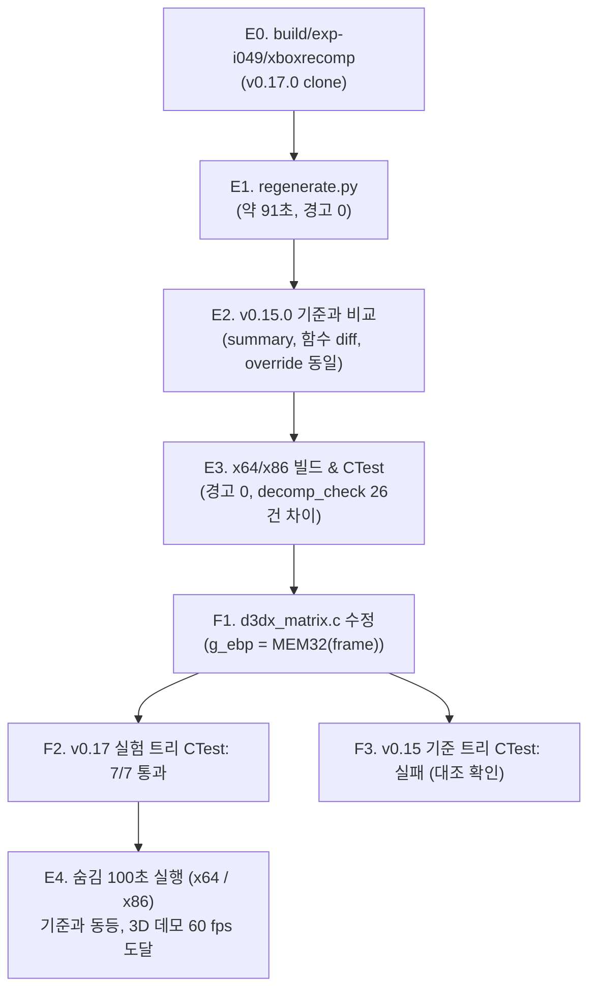

# 작업 로그: xboxrecomp v0.17.0 적용 검토 (issue #49)

작업 지시: [20261110-i049](../work-orders/20261110-i049-xboxrecomp-v0.17.md) · 설계: [20261110-i049](../design/20261110-i049-xboxrecomp-v0.17.md)

역할 분담: 총괄·설계·리뷰는 Claude, 실험과 문서 구현은 Antigravity.

## 한 일

1. **E0 (v0.17.0 클론)**: `build/exp-i049/xboxrecomp`에 로컬 submodule(`third_party/xboxrecomp`, 태그 포함)을 clone하고 `v0.17.0`(`343b6d8`)을 checkout했다. submodule checkout(`third_party/xboxrecomp`)은 건드리지 않았다.
2. **E1 (생성)**: `python3 scripts/recomp/regenerate.py --xboxrecomp build/exp-i049/xboxrecomp --gen-root build/exp-i049/gen`으로 생성했다. 오류 0, 경고 0. 단계 시간의 합은 약 91초(parse 0.0초, disasm 50.4초, func_id 0.5초, abi 0.7초, lift 39.7초).
3. **E2 (기준 gen/ct3_jp와 비교)**:
   * **a) summary 비교 표**:

     | 항목 | v0.15.0 (기준) | v0.17.0 (실험) |
     |---|---|---|
     | total | 4932 | 4917 |
     | translated | 4931 | 4916 |
     | failed | 0 | 0 |
     | total_lines | 717737 | 672296 |
     | unresolved_stubs | 0 | 1 (`sub_001232E1`) |
     | manual_functions | 257 | 257 |
     | unimplemented: arpl | 1 | 0 |
     | unimplemented: cli | 2 | 1 |
     | unimplemented: daa | 1 | 1 |
     | unimplemented: das | 0 | 4 |
     | unimplemented: hlt | 4 | 2 |
     | unimplemented: insb | 7 | 0 |
     | unimplemented: insd | 2 | 0 |
     | unimplemented: int | 1 | 1 |
     | unimplemented: outsb | 3 | 4 |
     | unimplemented: outsd | 0 | 3 |
     | unimplemented: wbinvd | 1 | 0 |
     | unimplemented (합계) | 22 (9종) | 16 (7종, `RECOMP_UNIMPL` 호출) |

   * **b) 함수 시작 주소 집합 차이**: 기준 4,916개, 실험 4,905개. 새로 생긴 함수 12개(대표: `0x0005E280`, `0x0007C3B0`, `0x0007CBA0`, `0x0008D7F0`, `0x000B8490`, `0x000C5BE0`, `0x000C5C50`, `0x000C6F90`, `0x000EF410`, `0x000FBAB0`), 없어진 함수 23개(대표: `0x00011A98`, `0x000633A0`, `0x000633A4`, `0x00098D17`, `0x00098E4C`, `0x000B3CD8`, `0x000B43C8`, `0x000BAB60`, `0x000C04B1`, `0x000C0521`).
   * **c) override 수**: `hle_overrides.c` 246개(246 슬롯), `overrides.c` 257개(246 슬롯)로 두 판이 완전히 같다.
   * **d) check_hle_pops.py**: 기준 0건, 실험 0건으로 불일치 없다.
   * **e) decomp 대체 함수 경계**: `src/game/ct3/decomp/`가 대체하는 16개 함수(`sub_000B2640`, `sub_000B2730`, `sub_000B2A90`, `sub_000B2FF0`, `sub_000B3030`, `sub_000B7EE0`, `sub_000B9190`, `sub_000B9540`, `sub_000BB9C0`, `sub_000BC950`, `sub_000BC970`, `sub_000DDD43`, `sub_000DDD95`, `sub_000E4B73`, `sub_000E4BB9`, `sub_000E4CB7`)의 시작·끝·크기가 두 판에서 100% 일치한다.
   * **추가 리뷰 (Claude)**: 없어진 23개 함수는 v0.17 dispatch에서도 빠졌으나 `find_pointer_targets` 후보는 두 판 동일하게 6개로 포인터 대상이 아니다. 새 스텁 `sub_001232E1`과 사라진 `sub_00121201` 등은 호출자가 없는 `0x120016`~`0x123320` 영역(`tail_jump_alias`, v0.15의 미구현 명령 `daa`/`outsb`/`hlt`가 몰려 있던 곳)에 위치하며 데이터를 코드로 읽은 곳으로 **추정**된다. 새로 생긴 10개 함수는 `gap_prologue`(직접 호출자 없음)이고 `sub_000C6F90`은 `outsd` 3개를 갖는다.
4. **E3 (실험 트리 빌드와 테스트)**:
   * `build/exp-i049/build/linux-x64-release` 및 `linux-x86-release`를 빌드했다. 컴파일러 경고(' warning: ') 0건, 에러 0건.
   * CTest는 두 플랫폼 모두 6/7 통과, `7 - rect3_decomp_check` 1건 실패. `sub_000E4CB7`(D3DXMatrixInverse) 26개 케이스에서 `ebp`/`g_seh_ebp`가 `decompiled 00EFFEFC lifted 55555555`로 불일치했다. 원인: v0.17.0은 `leave; ret 12` 후 호출자의 원래 EBP를 정상 복원(`g_ebp = ebp; g_seh_ebp = ebp;`)하는 반면, 디컴파일 코드는 복원하지 않던 v0.15.0의 결함에 맞춰 `g_ebp = frame; g_seh_ebp = frame;`으로 작성되어 있었다(**확인됨**).
5. **F1~F3 (decomp 수정 시험 및 대조)**:
   * **F1**: `src/game/ct3/decomp/d3dx_matrix.c` 323~324행을 수정했다(258행 `MEM32(frame) = g_ebp;` 이후 덮어쓰기 없음 확인):

     ```diff
     --- a/src/game/ct3/decomp/d3dx_matrix.c
     +++ b/src/game/ct3/decomp/d3dx_matrix.c
     @@ -323,2 +323,2 @@
     -    g_ebp = frame;
     -    g_seh_ebp = frame;
     +    g_ebp = MEM32(frame); /* leave: the caller's ebp, saved at entry */
     +    g_seh_ebp = g_ebp;
     ```

   * **F2**: v0.17.0 실험 트리를 다시 빌드하고 CTest를 실행하여 x64와 x86 모두 7/7 통과(100% passed)를 확인했다.
   * **F3 (대조)**: 기준 트리(`build/linux-x64-release`, v0.15.0 gen)를 다시 빌드하고 CTest를 돌렸다. 예상대로 `rect3_decomp_check`가 26건 불일치(`decompiled 55555555 lifted 00EFFEFC`)로 실패했다. 따라서 이 수정은 submodule 고정 상향 커밋과 반드시 함께 반영되어야 한다.



## 검증: E4 숨김 실행 100초

저장소 루트에서 순차 실행했다(x86은 `SDL_VIDEO_DRIVER=x11`).

| 항목 | v0.15.0 기준 (2026-11-10) | v0.17.0 실험 (x64) | v0.17.0 실험 (x86) |
|---|---|---|---|
| 종료 코드 | 4 (워치독 100s 정상) | 4 (워치독 100s 정상) | 4 (워치독 100s 정상) |
| [d3d8] display | 1280x960, OpenGL 3.3, RTX 4090 | 1280x960, OpenGL 3.3, RTX 4090 | 1280x960, OpenGL 3.3, RTX 4090 |
| 멈춤·stall·no target | 없음 | 없음 | 없음 |
| unimpl/unresolved 로그 | unresolved 0건(v0.15.0은 미구현 명령을 주석으로만 남겨 실행 보고가 없다) | 0건 (`[recomp]` 보고 없음) | 0건 (`[recomp]` 보고 없음) |
| 타이틀 화면 fps / CPU | 60.0 fps (CPU 0.7~1.8 ms / x86 1.1~2.6 ms) | 59.8~60.0 fps (CPU 0.79~1.32 ms) | 59.9~60.0 fps (CPU 1.03~2.48 ms) |
| 타이틀 화면 draws | 3~10 | 3~10 | 3~10 |
| 3D 데모 fps / CPU | 59.5~59.9 fps (CPU 4.1~5.5 ms / x86 6.0~7.4 ms) | 59.8~60.0 fps (CPU 4.06~5.25 ms) | 59.5~60.0 fps (CPU 5.58~7.34 ms) |
| 3D 데모 draws | 590~949 (x86 571~923) | 594~798 | 587~923 |

## 판단: 조건부 적용

설계 §6에 따라 **조건부 적용**으로 판단한다.

* 고정 상향을 막는 원인은 `d3dx_matrix.c`의 `sub_000E4CB7` 에필로그 2줄뿐이며, 호출자의 EBP를 정상 복원하는 2줄 수정으로 v0.17.0 트리의 CTest가 7/7 전원 통과한다.
* 생성 오류 0, 빌드 경고 0, HLE override 및 pop 검증 동일, 디컴파일 대상 함수 경계 동일, 100초 숨김 실행에서 멈춤·stall·스텁 히트 없이 3D 데모가 기준과 동등하게 정상 구동된다.
* 없어진 23개 함수는 포인터 대상이 아니며, 새 미해결 스텁 `sub_001232E1`은 호출자가 없는 영역에 있어 런타임에 영향을 주지 않는다.

## 남은 것

* 사용자 결정 후 같은 issue에서 submodule 고정 상향(`v0.17.0`, `343b6d8`), 디컴파일 수정, 재생성, 문서 갱신 커밋.
* Windows 기계에서 생성 코드가 포함된 Win32 x86 빌드, CTest, 실행 확인(이 실기에서는 수행 불가).
* 주행 조작 등 어트랙트 데모 밖의 인게임 장면 확인.

---

# Work log: reviewing xboxrecomp v0.17.0 (issue #49)

Work order: [20261110-i049](../work-orders/20261110-i049-xboxrecomp-v0.17.md) · Design: [20261110-i049](../design/20261110-i049-xboxrecomp-v0.17.md)

Division of roles: Claude led, designed and reviewed; Antigravity ran the experiments and wrote the documents.

## Done

1. **E0 (v0.17.0 clone)**: Cloned the local submodule (`third_party/xboxrecomp`, tags included) into `build/exp-i049/xboxrecomp` and checked out `v0.17.0` (`343b6d8`). The submodule checkout (`third_party/xboxrecomp`) was not touched.
2. **E1 (generation)**: Ran `python3 scripts/recomp/regenerate.py --xboxrecomp build/exp-i049/xboxrecomp --gen-root build/exp-i049/gen`: 0 errors, 0 warnings; the steps add up to about 91 s (parse 0.0 s, disasm 50.4 s, func_id 0.5 s, abi 0.7 s, lift 39.7 s).
3. **E2 (comparison with baseline gen/ct3_jp)**:
   * **a) Summary table**: Total functions 4,932 -> 4,917; translated 4,931 -> 4,916; failed 0; lines of C 717,737 -> 672,296; unresolved stubs 0 -> 1 (`sub_001232E1`); manual functions 257 -> 257; unimplemented instructions 22 (9 mnemonics) -> 16 (7 mnemonics, emitted as `RECOMP_UNIMPL` calls).
   * **b) Function address differences**: Baseline 4,916 functions, exp 4,905 functions; 12 added (samples: `0x0005E280`, `0x0007C3B0`, `0x0007CBA0`), 23 removed (samples: `0x00011A98`, `0x000633A0`, `0x000633A4`).
   * **c) Override counts**: `hle_overrides.c` 246 functions (246 slots), `overrides.c` 257 functions (246 slots), identical on both.
   * **d) check_hle_pops.py**: 0 mismatches on both.
   * **e) Decompiled function boundaries**: All 16 functions replaced under `src/game/ct3/decomp/` have identical start, end, and size between both versions.
   * **Additional review (Claude)**: The 23 removed functions are also omitted from v0.17 dispatch, but `find_pointer_targets` candidates are identical across both versions (6 candidates) -> not pointer targets; the new stub `sub_001232E1` and removed `sub_00121201` lie in the caller-less `0x120016`–`0x123320` region (`tail_jump_alias`, where v0.15 unimplemented instructions `daa`/`outsb`/`hlt` clustered, **inferred** to be data read as code); 10 new functions are `gap_prologue` with no direct caller, and `sub_000C6F90` contains 3 `outsd`s.
4. **E3 (build and CTest in exp tree)**:
   * Built `build/exp-i049/build/linux-x64-release` and `linux-x86-release`: 0 compiler warnings, 0 errors.
   * CTest on both platforms: 6/7 passed, with test 7 `rect3_decomp_check` failing on `sub_000E4CB7` in 26 cases (`ebp`/`g_seh_ebp` decompiled `00EFFEFC` vs lifted `55555555`). Cause: v0.17.0 restores the caller's EBP upon `leave; ret 12` (`g_ebp = ebp; g_seh_ebp = ebp;`), while the decompiled code was written against v0.15.0 where the frame value was left behind (**confirmed**).
5. **F1–F3 (decomp fix test and control check)**:
   * **F1**: Changed lines 323–324 of `src/game/ct3/decomp/d3dx_matrix.c` to `g_ebp = MEM32(frame); g_seh_ebp = g_ebp;` (verified `MEM32(frame)` is not overwritten after line 258).
   * **F2**: Rebuilt the v0.17.0 experiment trees; CTest passes 7/7 on both x64 and x86.
   * **F3 (control)**: Rebuilt baseline `build/linux-x64-release` (v0.15.0 gen); CTest fails on `rect3_decomp_check` with the reversed difference (`decompiled 55555555 lifted 00EFFEFC`). This confirms the fix must be committed alongside the pin advance.

## Verification: E4 hidden 100 s runs

Ran sequentially from the repository root (`SDL_VIDEO_DRIVER=x11` for x86):
Both x64 and x86 reached exit code 4 (watchdog expiration) with no stops, stalls, or `no target`, and 0 `[recomp] untranslated` or `unresolved stub` log lines (v0.15.0 leaves unimplemented instructions as comments only, so its runs cannot report them). On x64: title screen 59.8–60.0 fps (CPU 0.79–1.32 ms, draws 3–10), 3D demo 59.8–60.0 fps (CPU 4.06–5.25 ms, draws 594–798). On x86: title screen 59.9–60.0 fps (CPU 1.03–2.48 ms, draws 3–10), 3D demo 59.5–60.0 fps (CPU 5.58–7.34 ms, draws 587–923). Performance and behavior are on par with the v0.15.0 baseline.

## Verdict: adopt with changes

Following design section 6, the verdict is **adopt with changes**:
The only blocker was the 2-line fix in `d3dx_matrix.c`, with which all 7 CTest tests pass; no generation errors, 0 build warnings, overrides and ABI pops unchanged, and 100 s hidden runs match the baseline with 0 stub or untranslated instruction hits.

## Left open

* Advance the submodule pin to `v0.17.0` (`343b6d8`), commit the decomp fix, regenerate, and update documentation after user decision (same issue).
* Win32 x86 build, CTest, and run with generated code on a Windows machine (not possible on this machine).
* In-game scenes outside the attract demo (such as active driving).
